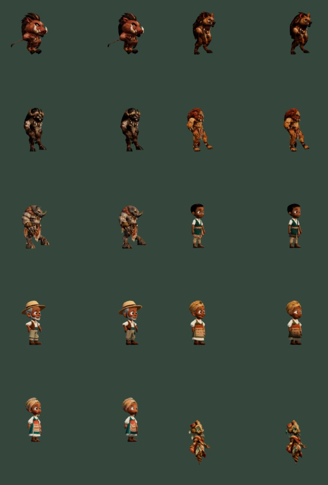

# LOD de personajes — 30 octubre 2026

Implementados cinco animales, cuatro trabajadores y el Guardián. Los modelos originales permanecen intactos. Las copias lejanas se generan con Decimate de Blender 4.5.3 y mapas de hasta 256×256, conservando UV, normales/PBR y AO interpolada.

| Personaje | Triángulos originales | LOD | GLB KiB |
|---|---:|---:|---:|
| warthog | 22,260 | 1,744 | 548 |
| hyena | 20,181 | 1,798 | 690 |
| buffalo | 22,697 | 1,749 | 631 |
| lion | 20,654 | 1,677 | 661 |
| rhino | 20,848 | 1,632 | 806 |
| youngMale | 54,121 | 1,847 | 522 |
| olderMale | 48,965 | 1,835 | 579 |
| olderFemale | 57,931 | 1,860 | 527 |
| youngFemale | 50,718 | 1,830 | 584 |
| guardian | 25,729 | 1,710 | 581 |

## Distancia y criterio visual

El cambio depende de la altura proyectada: entrar en LOD por debajo de **65 píxeles del render**, recuperar el original por encima de **82**. La histéresis evita cambios repetidos. Tiene en cuenta perspectiva, resolución, zoom ortográfico y cambios de escala. El Guardián guiando el tutorial siempre conserva detalle completo.

Se compararon los diez personajes, originales a la izquierda y LOD a la derecha, a 120 y 65 px y desde un segundo ángulo de 45°. A 120 px son visibles la simplificación de cara, contorno y sombreado; a 65 px la diferencia es mucho menor. 65 es un umbral conservador de esta revisión, no una afirmación de invisibilidad universal. Hay capturas por personaje y tamaño en esta carpeta.



En el motor real, la hiena pasa a unos 63,7 px con el control de distancia horizontal de 34 m; a 12 m ronda 190 px y recupera el original. No se debe generalizar esa distancia a todas las especies o resoluciones. A FOV vertical 42° y render de 900 px, la profundidad aproximada para una figura de 1,7 m es 30,7 m; para una figura de 2,9 m es 52,3 m. Fórmula: altura × resoluciónVertical / (2 × tan(FOV/2) × 65).

## Corrección de geometría e integración

La primera reducción directa produjo huecos al colapsar vértices separados por costuras de UV/normales. Se descartó. La versión final suelda coincidencias antes de Decimate conservando UV por esquina, prioriza el cuerpo sobre párpados/interiores/accesorios, elimina degenerados y separa uniones de más de dos caras sin cerrar aberturas intencionales. Los informes JSON detallan topología por malla. No equivale a afirmar que ropa y bocas sean sólidos estancos.

Los LOD usan los huesos originales, sin otro mixer. Conservan transformaciones de herramientas y portadores de recuperación. La malla canónica sigue disponible para picking, contactos, física y navegación; solo cambia la visibilidad de dibujo. El LOD es un hermano fuera de su jerarquía, para no contaminar sus medidas físicas. Recursos compartidos se conservan; esqueletos/materiales privados se liberan al retirar actores. Ante fallo de carga se conserva el original.

Las copias lejanas no contienen morph targets faciales. La expresividad completa se mantiene en el original cercano. El coste CPU de evaluar animaciones originales no se elimina y las texturas originales permanecen residentes: esta primera integración reduce principalmente trabajo geométrico, no promete ahorro total de memoria.

## Validación realizada

- Validador glTF: diez archivos, cero errores. Advertencias de mallas skinned no raíz documentadas en `validation.json`; se enlazan explícitamente a los huesos canónicos en ejecución.
- 25 pruebas automatizadas aprobadas: presupuesto, texturas, todos los clips muestreados, huesos compartidos, transformaciones no skinned, escala, limpieza, herramientas y materiales AO.
- Otras 38 pruebas del ciclo de vida y de instancia unica del Guardian aprobadas.
- Build de producción correcto. Conserva advertencias de tamaño de chunks; el trabajo de distribución queda aplazado por prioridad del usuario.
- Comparador gráfico: diez modelos, dos tamaños y dos orientaciones; inspección visual de silueta y articulaciones.
- Wild Engine real sobre Intel UHD: alternancia original/automático cerca/lejos, escena diurna, lanzamiento nocturno con Guardián LOD y caída física de hiena. Metadatos de las capturas sin errores de runtime.
- No se declara validada aquí una revisión visual completa de todas las recuperaciones, especies, biomas y dispositivos. Las muestras de clips automatizadas no sustituyen esa revisión.

## Medición acotada

En la misma escena congelada (elapsed 34.049374999947545), 32 trabajadores, 13 estructuras y 144 cultivos, el contador gráfico pasa de **2.027.633 a 1.083.913 triángulos** (−46,5% del conjunto). Las llamadas de dibujo se mantienen en **195**. Datos: `workers-high.json` y `workers-auto.json`. Es una medición de contadores de esa escena, no una comparativa de FPS ni una prueba de mejora de CPU/GPU. La compilación inicial de materiales y los picos de primera carga no están caracterizados por este par. No se extrapolan los pilotos previos A/B a un resultado definitivo de esta integración.

## Reproducir

Desde la raíz del repositorio:

```powershell
node tools/guardian/prepare-character-lod.mjs
& 'C:/tmp/guardian-tools/blender-4.5.3-windows-x64/blender.exe' -b -t 4 --python-exit-code 1 --python tools/guardian/build-character-lod.py
node tools/guardian/validate-character-lod.mjs
node --test tests/character-lod.test.js tests/animal-preload.test.js tests/worker-tool-visibility.test.js tests/guardian-material-ao.test.js
npm run build
npm run dev -- --host 127.0.0.1 --port 5194
```

Abrir `/tests/browser/character-lod-review.html` para comparar clips y tamaños. Abrir `/tests/browser/guardian-combat.html?nativeRaid&lightingReview&characterLod=auto` para el motor real; seleccionar distancia y modo LOD. Activar **Simular movimiento real** para evaluar físicas: el modo de presentación solo reproduce efectos. Los parámetros QA no alteran partidas de producción.

Fuentes editables: `content/source/character-lod/*.blend`. Manifest de origen y hashes: `sources.json` y `validation.json`. GLB finales: `public/content/character-lod/`. No se incorporan recursos externos.
