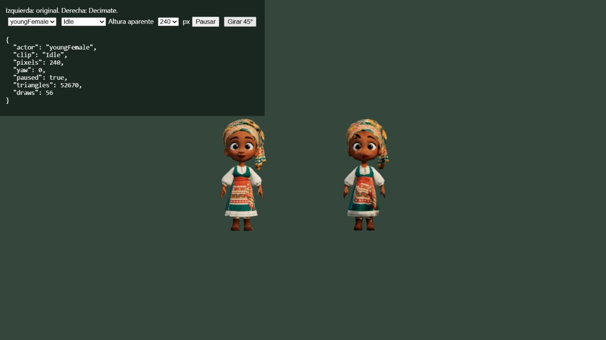
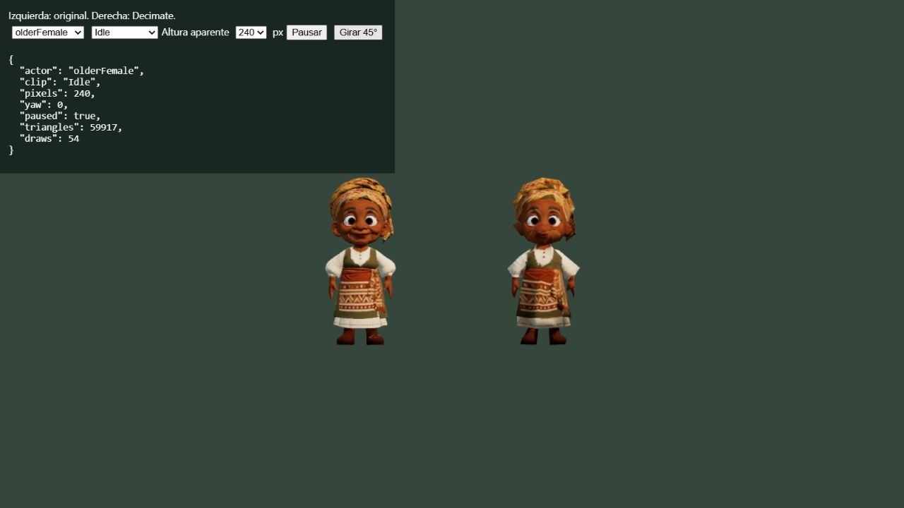
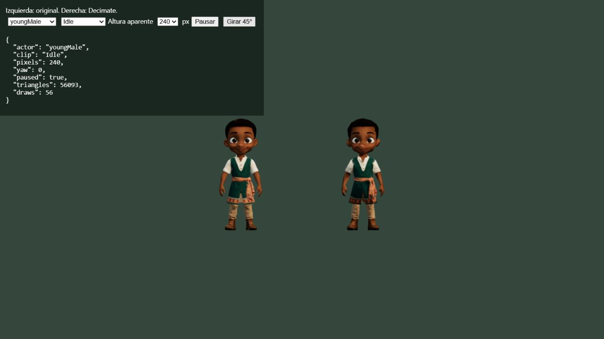

# Contorno ocular de trabajadores LOD

Revisión limitada a youngMale, youngFemale y olderFemale, solicitada tras la aprobación visual de los demás LOD. Los GLB de las bestias, olderMale y Guardian permanecen idénticos.

La reducción uniforme dejaba entre 24 y 28 triángulos en los párpados y simplificaba excesivamente el globo ocular integrado en el cuerpo. Se reserva un presupuesto de 150 triángulos para los párpados y se pondera Decimate por proximidad a sus superficies originales, conservando más detalle en ojos y contorno. El grupo temporal se elimina antes de exportar para no alterar las influencias del rig.

Resultados: youngMale 1972 tris; youngFemale 1952; olderFemale 1986. Mapas de 256 px y umbrales LOD sin cambios. Se repararon dos tangentes nulas exportadas en esquinas UV colapsadas de youngFemale con una base ortogonal a la normal; no se modifican los mapas ni normales originales.

Revisión gráfica en Three.js: frente y 45 grados a 240 px, más frente a 65 px; original a izquierda, LOD a derecha. olderMale se incluye como referencia sin editar. A tamaño cercano siguen visibles las simplificaciones propias del LOD fuera de los ojos; producción recupera el original por encima de 82 px.

Validador glTF: cero errores en los diez GLB. Once pruebas de presupuestos, mapas, clips, enlace de huesos y ciclo de vida aprobadas. No se atribuye una mejora de rendimiento a esta corrección artística.

