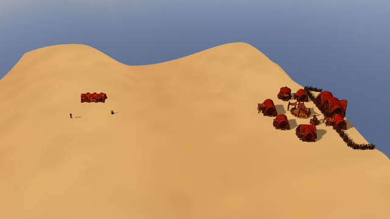

# Retirada Home en el consumidor real

Continúa la [retirada nativa preparada](e-r3-native-home-arrival-source-20261115.md) y su [participante reversible del roster](e-r3-native-home-absence-roster-20261115.md), siguiendo el [plan principal](integrated-gpu-migration-plan-20261104.md). La llegada genuina sin cruces de puertas puede ahora retirar el cuerpo y presentar la ausencia del mismo actor mediante los puertos, Surface y consumidor existentes. NVIDIA/Turing valida **cero creaciones al preparar y cero después de READY**. La restauración nueva y las demás clases pendientes mantienen abiertos A6/e-R3/e-R4/f-R4/A/B/C.

## Referencias aplicadas

Se utilizó el código real ya contrastado de Three r180: [`Renderer._projectObject`](https://github.com/mrdoob/three.js/blob/r180/src/renderers/common/Renderer.js#L2645), que excluye raíces invisibles de la lista de dibujo, y [`Object3D.remove`](https://github.com/mrdoob/three.js/blob/r180/src/core/Object3D.js#L772), que separa participación y destrucción de recursos compartidos. La captura oculta temporalmente la raíz y la restaura antes de esperar el ACK; el commit efectivo y la retirada diferida conservan la vida del propietario anterior.

Para el relevo se aplicaron los patrones de [Dawn, reserva y generación de identidad](https://github.com/google/dawn/blob/922930e3193753e58591f14a96ab116e5d630964/src/dawn/wire/server/ObjectStorage.h#L240), y [finalización real de la cola por identidad](https://github.com/google/dawn/blob/922930e3193753e58591f14a96ab116e5d630964/src/dawn/wire/server/ServerQueue.cpp#L35). La adaptación correlaciona la fuente capturada con la revocación emitida y conserva el drenaje del trabajo enviado. No incorpora dependencias, otro reloj de movimiento, registro de finalizaciones, renderer o cola.

## Implementación

`HomeArrival` utiliza el mismo cliente/receptor/conexión de recursos y el mismo slot retenido de Surface. No necesita textura de ruta, soporte de otro corredor ni variantes nuevas. El roster graba la ausencia y ejecuta `afterCapture` de forma síncrona antes de esperar el paquete; READY mantiene visible y seleccionable el extremo todavía presentado. Preparar y cancelar conservan el cuerpo Home.

El consumidor admite la plantilla contra su asociación Home vigente. El paquete de ausencia no puede seguir referenciando el reloj de ese actor. El ACK con `nativeHomeArrivalVersion=1` sólo se emite tras comprobar el paquete retenido y completar `queue.onSubmittedWorkDone()`. La publicación exige la versión, plantilla y secuencia de fotograma reales antes del commit nativo.

La liberación transporta una única asociación de retirada emitida. El control gráfico comprueba el registro revocado que ya existía: actor y handle originales, asignación Home, secuencia de retirada, estado cancelado, tiempo seguro y reloj/frontera actuales. La referencia por sí sola no autoriza la ausencia, y el resultado no concede tiempo de movimiento. No se instala un mapa de permisos de llegada. Las llegadas con cruces de puertas conservan un rechazo explícito en Surface y host hasta preparar y validar sus gráficos. Los hechos históricos `nativeHomeArrivals` siguen rechazándose en bootstrap; también continúa la protección de Home guardado que todavía requiere admisión nueva.

El consumidor puede presentar el paquete admitido mientras el preparador sigue bloqueado. El commit proyecta `home` y elimina el cuerpo mediante el propietario nativo ya validado. Tras presentar, el roster retira su antiguo propietario Home y conserva su mismo estado `nativePending/adopting` hasta recibir la publicación coherente de `home`. Así una publicación antigua `returning` no activa el fallback ni vuelve a mostrar al actor. La publicación confirmada elimina después su entrada una sola vez; actores y lotes ajenos permanecen residentes.

## Validación

La [evidencia reproducible](performance/native-home-absence-consumer-validation-20261115.json) contiene comandos, archivos y límites:

- **667/667 pruebas en 63 archivos**, sin omisiones, 121,806 s. La selección dirigida de protocolo es **31/31**, incluida en la regresión. Comprueba origen exacto/tardío, canal y refresco, plantilla ausente, reloj del actor todavía presente, asociación omitida, capacidad no soportada, ACK real alterado en versión/plantilla/fotograma, secuencia sustituida, control obsoleto y drenaje diferido conservando el cuerpo.
- Un loader de sólo lectura carga el roster de `b9fd3e234` en su URL original con el resto del código actual. Reproduce **un fallo con ocho casos fuera de selección**: una publicación antigua vuelve a poner `root.visible=true` tras retirar el movimiento Home. El estado de adopción actual y la prueba de hardware impiden esa resurrección. No es una comparación integral del commit padre.
- WebGPU real, NVIDIA/Turing, recursos originales y puertos reales: **2911 → 2911 → 2911 creaciones acumuladas** antes, en READY y después. Cero creaciones en preparación o después de READY; tampoco hay nuevos forks de uniformes, bindings, buffers o texturas tras READY.
- **52 dibujos durante bloqueo real de preparación de 1,8 s**. El actor pasa de dos raíces residentes a una; la raíz superviviente, sus huesos, geometrías/materiales y los lotes del mundo conservan sus identidades. El otro cuerpo nativo sigue avanzando.
- El extremo se conserva y selecciona antes del commit, incluido READY. Después desaparecen su cuerpo y reloj Home, Game refleja `home` e inactividad nativa y la selección ordinaria de las cuatro alturas encuentra la aldea. La economía no vuelve a cobrarse. Se drena explícitamente la publicación antigua y el cierre final del consumidor; cero errores GPU, de página, consola o red.

Compilación de producto correcta en **46.51 s**, con los avisos existentes. Los **16 hashes originales protegidos** mantienen sus valores exactos después de compilar.

Antes de la retirada:

Después de la retirada:

Las imágenes revisadas mantienen la misma cámara inicial amplia y el mundo original de desierto. La fuente está en la página de prueba y B sigue siendo el fixture Home independiente explícito. Se avanza el **reloj nativo** desde 49,694 hasta 123,628 para ejecutar el extremo completo, como en los checkpoints de acción y entrega; no se teletransporta el cuerpo desde JS ni se cambia el destino. Esto no acredita reproducción visual en tiempo real de todo ese corredor, el productor ordinario o paridad visual de una partida completa. Los módulos nativos permanecen iguales a `214f2a758`.

Este relevo normal acredita reutilización incremental y no reconstruye los 3123 recursos del ensayo de recuperación. **La recuperación integral de ese caso con dispositivo sano sigue pendiente**, junto con la aceptación completa de costes y continuidad de C.

## Siguiente punto

Admitir de nuevo los Home guardados y los cohortes con trabajadores ya inactivos, desde su semántica y una sesión nueva, sin restaurar asociaciones o marcas históricas. Continúan después el cambio de contrato desde Idle activo, Idle inicial, otros finales/cancelaciones, consumidores con puertas, productor ordinario, recuperación y aceptación A6/A/B/C antes de D.
