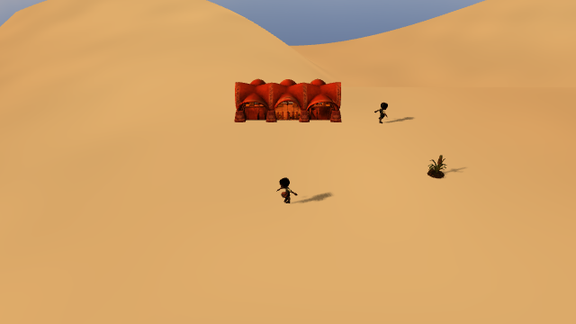

# Home en el consumidor gráfico existente

Continúa la [ruta Home nativa](e-r3-native-home-route-source-20261115.md) del [plan principal](integrated-gpu-migration-plan-20261104.md). El mismo actor residente pasa de la disponibilidad estacionaria con contrato terminado al corredor Home genuino. La preparación precede a la transferencia del cuerpo y el consumidor exige su asignación nativa real. **La llegada y retirada al entrar en la aldea siguen pendientes**; no cambia ningún cierre A6/e-R3/e-R4/f-R4/A/B/C.

## Referencias y decisiones

Se leyeron las implementaciones reales de [Three r180, `_bindAction` y `_activateAction`](https://github.com/mrdoob/three.js/blob/r180/src/animation/AnimationMixer.js#L53): reutilización de bindings por raíz/pista y referencias separadas del uso activo. Se adapta ese patrón a la vida del actor y sus variantes GPU existentes, conservando raíz, huesos y geometrías durante activación, rollback y retirada. No se introduce otro mixer ni evaluación periódica del rig.

En Dawn se contrastaron [`FillReservationImpl`, estado reservado y generación](https://github.com/google/dawn/blob/922930e3193753e58591f14a96ab116e5d630964/src/dawn/wire/server/ObjectStorage.h#L240) y [`DoQueueOnSubmittedWorkDone`/`OnQueueWorkDone`, identidad de la finalización real](https://github.com/google/dawn/blob/922930e3193753e58591f14a96ab116e5d630964/src/dawn/wire/server/ServerQueue.cpp#L35). La adaptación comprueba identidad y generación antes de asociar el recurso retenido y conserva el drenaje aceptado hasta la respuesta de la cola. No añade dependencias, propietarios, colas ni temporizadores.

## Implementación

Home utiliza el mismo puerto de preparación, tabla de ruta, soporte de terreno confirmado, roster, variantes Walk/Run/Idle y slot de fotograma retenido. La preparación mantiene el Idle anterior y el cuerpo estacionario. Rechaza tareas ficticias, cajas, recuperación, otra aldea o una fuente estacionaria distinta. Activación, rollback y eliminación conservan las reglas de vida del relevo anterior.

La publicación transporta la plantilla Home exacta y exige la capacidad `nativeHomeRouteVersion=1` emitida por el consumidor real. El ACK espera el fotograma y su reloj relativo Home preparados, además de `queue.onSubmittedWorkDone()`. La liberación admite una única asociación emitida, correlacionada con la asignación directa y su fuente estacionaria. Una referencia o el fotograma por sí solos no autorizan movimiento. Se anuncia la capacidad después de conectar este recorrido; el bootstrap de un Home guardado continúa rechazándose.

El reloj tipado admite la época efectiva revalidada y conserva los recursos preparados. La edad relativa se calcula desde esa época antes de convertirla a float32. La selección ordinaria utiliza el testigo del último envío GPU y el mismo actor animado. La publicación de semántica antigua se drena mediante la espera de adopción existente antes de aceptar el nuevo propietario `native-home`; no hay otro caminante, rig ni validador de rutas por fotograma.

Una prueba dirigida detectó 100 serializaciones de procedencia en 50 consultas a una autorización estacionaria. Ahora la asociación inmutable se compara una vez por instalación dentro de su lease. Cada consulta sigue comprobando propietario vivo, estado, secuencia y ruta; un cambio de prueba o la retirada invalida el lease. La prueba cubre también la transición preparada a Home y cero serializaciones repetidas. Es una corrección estructural de admisión, sin atribuirle una mejora de FPS medida.

La ejecución GPU descubrió además una carrera real de retirada del consumidor: un fotograma del productor llegaba después de aceptar `NativeControlRetire`. El rechazo fatal impedía enviar el ACK del drenaje ya iniciado. El host devuelve ahora la cancelación existente de fotograma obsoleto o el rechazo RPC correspondiente, sin escribir ni enviar trabajo nuevo a GPU ni anular el drenaje aceptado. Otros errores y device loss conservan sus vías de fallo. Esta retirada de conexión no equivale todavía a la retirada preparada del trabajador al llegar a casa.

## Validación y límites

La [evidencia reproducible](performance/native-home-route-consumer-validation-20261115.json) incluye la lista de archivos y el comando de ejecución:

- **624/624 pruebas en 58 archivos**, sin omisiones, 109,205 s. Incluyen las 603 anteriores, preparación y canal, control directo, relojes y selección, shaders reales de color/sombra de Three, rollback/eliminación y regresión de retirada. Los casos con cola GPU simulada se distinguen de la ejecución de hardware.
- NVIDIA/Turing, WebGPU real, recursos originales y puertos reales: **98 creaciones al preparar** (2902 → 3000), **cero después de READY**, mismos actores, huesos, geometrías y lotes del mundo. No hay forks de uniformes, bindings, buffers o texturas después de READY.
- **52 dibujos** durante bloqueo real de preparación de 1,8 s. El trabajador avanza por Home sin tarea ni caja, la selección acierta en `worker-900011`, la economía permanece idéntica y la retirada final del consumidor drena. Cero errores GPU, de página, consola o red.
- Dos ejecuciones anteriores fallaron en el cierre por la carrera descrita, aunque Home se dibujaba y seleccionaba. No se aceptan como pases. La prueba de reproducción falla antes del arreglo; la selección posterior pasa 12 casos con 129 fuera de selección. Los 141 casos de ese archivo están incluidos sin omisiones en la regresión final.
- Los módulos nativos no cambian respecto a `5aeb8274a`; las pruebas usan los artefactos canónicos reales standalone y pthread. Compilación de producto correcta en **44,50 s**, con los avisos existentes; los **16 hashes originales protegidos** mantienen sus valores exactos después de compilar.

La imagen revisada muestra el retorno sin caja y los dos actores originales en el escenario mínimo de desierto. La fuente nativa se ejecuta en la página de prueba; el actor independiente sigue siendo el fixture Home explícito. Esto no acredita todavía el productor ordinario, paridad visual de una partida completa ni la recuperación integral del caso de 3123 recursos. Sólo se preparó el delta de esta transición.

## Siguiente punto

Preparar la llegada y retirada del cuerpo en la entrada real de la aldea mediante los mismos propietarios y protocolo, sin anticipar `home`, ocultación ni liberación. Después quedan la admisión nueva del Home guardado, cambio de contrato desde Idle activo, Idle inicial, otros finales/cancelaciones, puertas y productor ordinario de todas las clases. La recuperación integral y aceptación A6/A/B/C preceden a D.
