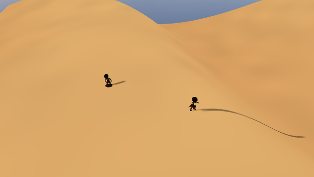
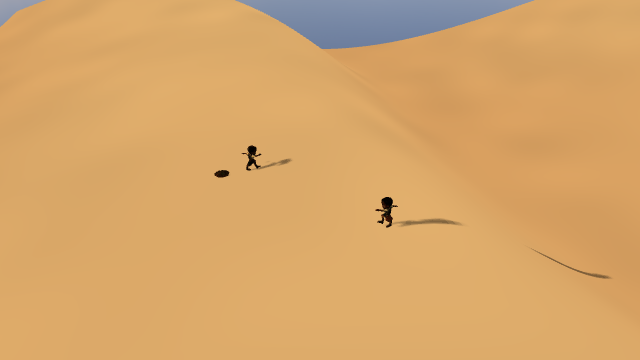

# Consumidor preparado del ciclo Idle sobre el actor residente

Continúa el [grafo y reloj finitos de la familia 21](e-r3-native-idle-cycle-gpu-clock-20261116.md) desde `200129b4e`. Se completa su integración en roster, Surface y cliente de recursos originales, con descanso/vigilancia, un siguiente REST y Home inmediato comprobados en GPU real. No cambia ningún cierre A6/e-R3/e-R4/f-R4/A/B/C; la política Idle completa y el productor ordinario siguen pendientes.

## Referencias y decisiones

Se reutilizan los propietarios de clips, variantes reversibles y claves estructurales existentes, contrastados con el código real de Three 0.180.0: [AnimationMixer.clipAction](https://github.com/mrdoob/three.js/blob/r180/src/animation/AnimationMixer.js) y [Pipelines.getForRender](https://github.com/mrdoob/three.js/blob/r180/src/renderers/common/Pipelines.js). El siguiente ciclo conserva los programas compilados; no se añade otra arquitectura de animación ni una dependencia.

La medición encontró 16 llamadas de layout en cada ciclo. Se inspeccionó [WebGPUBindingUtils.createBindings](https://github.com/mrdoob/three.js/blob/r180/src/renderers/webgpu/utils/WebGPUBindingUtils.js): su WeakMap usa la identidad de `bindingsReference`; una nueva variante puede solicitar otro wrapper equivalente. Se contrastó con [Dawn, `GetOrCreateBindGroupLayout`](https://github.com/google/dawn/blob/922930e3193753e58591f14a96ab116e5d630964/src/dawn/native/Device.cpp): el layout interno se busca por contenido y el wrapper conserva etiqueta y compatibilidad. Se mantiene esa solución contrastada. No se deduplican objetos de la API cliente ni se incorpora otra caché al Host. La lectura del código de Dawn no mide cuántas asignaciones realiza el driver de estas pruebas.

También se inspeccionaron las implementaciones reales de [UniformsGroup.update/updateNumber](https://github.com/mrdoob/three.js/blob/r180/src/renderers/common/UniformsGroup.js) y [Attributes.update](https://github.com/mrdoob/three.js/blob/r180/src/renderers/common/Attributes.js). El primero compara valores; el segundo sube atributos cuya versión cambia o cuyo uso es dinámico. El roster de cultivos marcaba `iGrowth`/`iBlessing` como cambiados en cada publicación. Se adapta la comparación a float32 que ya utiliza `crop-batch.writeValues`: sólo se incrementa la versión del atributo que cambia, conservando las modificaciones pendientes hasta el dibujo. No se introduce una caché global de bytes ni se modifica Three.

## Propiedad y publicación

La preparación 20 existente comparte ahora su mecanismo estacionario con 21: exclusión de preparación, variante Idle/Alert residente, sustitución reversible del enlace de movimiento, retarget de reloj y nudo semántico, comprobación del recibo y retirada diferida. La primera adquisición exige el cuerpo20 real; las siguientes exigen la secuencia del ciclo anterior y su mismo cuerpo original. Una liberación obsoleta no retira al sucesor. El relevo a tarea/Home comprueba cuerpo, pose, perfil, sesión y secuencias genuinos.

Surface incorpora la familia al transactor y al slot de adopción existentes, con soporte del triángulo visible y selección desde el float efectivamente enviado. El DTO confirmado sólo permite los campos de la familia21 y exige la asociación exacta. Una publicación antigua con la misma etiqueta `native-idle` no basta para finalizar la adopción: se espera una secuencia nueva, incluyendo el caso de tarea/Home ya pendientes. El consumidor anuncia `nativeIdleCycleVersion:1` para esta admisión preparada; el bootstrap histórico activo sigue rechazado.

No hay nuevo reloj, propietario de RNG, registro de actores, cola de recuperación ni decisión de política en el renderer. La preparación conserva actor, huesos, geometrías, índices, texturas residentes y lotes; confirma únicamente el programa emitido por la fuente nativa.

## Evidencia y coste real

Resultados, hashes y lista exacta de los 96 archivos de regresión en [la validación](performance/native-idle-cycle-consumer-validation-20261116.json). Las 21 pruebas gráficas dirigidas cubren cuatro perfiles por descanso/vigilancia, rollback, cancelación, asociación ajena, ciclo siguiente y tareas/Home genuinos. El oráculo compara skinning con los assets originales a edades enviadas, incluido el extremo finito, con error inferior a 0,02 m. Los builders de Three comprueban color/sombra y ambos bancos/referencias de tiempo. Esas pruebas usan renderer/colas simulados; el hardware siguiente es evidencia independiente.

| Ejecución NVIDIA/Turing | Recursos de protocolo al preparar | Tras READY | Conservación |
| --- | ---: | ---: | --- |
| [Descanso → vigilancia](performance/native-idle-cycle-rest-gpu-20261116.json) | 96 | 0 | 533 IDs vivos de texturas y buffers de vértices/índices |
| [Vigilancia → siguiente REST](performance/native-idle-cycle-repeat-gpu-20261116.json) | 96 y 68 | 0 y 0 | 577 IDs en ambos ciclos; segundo programa sin shaders, pipelines ni pipeline-layouts nuevos |
| [Repetición de confirmación](performance/native-idle-cycle-repeat-confirmation-gpu-20261116.json) | 96 y 68 | 0 y 0 | 577 IDs y mismas comprobaciones, sin copias de buffers estáticos/texturas |
| [Home inmediato](performance/native-idle-cycle-home-gpu-20261116.json) | 96 y 98 | 0 y 0 | Conserva533 IDs; Home añade su tabla de ruta125×1 y sampler; conserva bancos residentes |

Estos recuentos **no incluyen** las asignaciones internas de copy-on-write del Host. Durante cada preparación se observan además **18–21 copias de buffers uniformes, 4512–4816 bytes, y 18–21 bindings dependientes** para proteger el paquete anterior. Los recibos registran los contadores antes, en READY y después: no hay copias de buffers estáticos/texturas ni asignaciones/copias posteriores a READY. Las 16 llamadas de layout por ciclo siguen existiendo; no se presentan como cero trabajo ni como una medición de asignaciones internas del driver.

El conjunto de IDs vivos depende de los recursos creados y ya retirados antes de cada checkpoint: no se exige un cardinal común entre ejecuciones. La comparación de IDs excluye recursos ya retirados y cubre también las retiradas posteriores a READY. El control inicial sólo contaba IDs y no detectaba dos copias nativas de atributos de cultivos de 128 bytes durante un REST posterior. El descriptor de la última copia y el mapa de atributos de QA identificaron `iBlessing`; se corrigió su suciedad redundante. Pasan 43 pruebas de roster/terreno de cultivos; un control negativo que restaura exclusivamente la escritura antigua en memoria reproduce el fallo de versiones. La corrección conserva los cambios reales de pose/bendición y su publicación pendiente.

En todos los escenarios se bloquea el preparador 1,8 s antes y después de READY mientras el Host mantiene al compañero independiente en movimiento. El progreso del compañero se comprueba por distancia acumulada de la ruta nativa: el corredor da la vuelta y comparar sólo sus posiciones inicial/final produjo un falso negativo aunque recorrió casi cinco metros. Después de verificar ese avance se retiene explícitamente el watermark de la fuente de prueba y se realizan ambas selecciones sobre el mismo checkpoint enviado; esto evita usar una posición antigua tras la primera llamada asíncrona y no mide latencia de clic sobre un objetivo en movimiento. Pasan dibujo continuado, selección ordinaria de ambos actores, frontera/reloj exactos, retirada drenada y cero errores GPU, página, consola, HTTP o solicitudes. Antes de retirar el control se detiene sólo el dibujo ordinario del preparador mediante su entrada de visibilidad existente; el Host permanece visible para presentar y liquidar el último paquete. El auditor comprueba también los errores runtime después de la retirada. Un intento inicial no detectaba una cancelación tardía al retirarse mientras el productor aún dibujaba; ya no se acepta ese cierre como correcto. Las capturas siguientes se inspeccionaron y copiaron sin modificar.

El escenario es un checkpoint mínimo de desierto, 640×360, calidad `muy_baja`, nueve sectores cargados y dos actores originales; sólo un perfil se ejecuta aquí en hardware. Home utiliza la entrada declarada sobre el corredor despejado comprobado, no la entrada ordinaria del pueblo fuera de esos sectores. La prueba proyecta explícitamente la fase nativa y, para el REST siguiente, refleja temporalmente la petición semántica deseada que exige el validador actual. Home usa la ABI nativa genuina después de publicar la adquisición21. Esto no demuestra aún la proyección/persistencia de Game21 ni su vencimiento ordinario de contrato.

Los módulos nativos y sus fuentes compiladas permanecen exactos; los 16 archivos locales ajenos protegidos conservan sus bytes. La regresión compartida y el build completos se detallan en el JSON de validación.

La regresión se puede repetir con Node20 y la lista `regression.files` del JSON, definiendo `WILD_ENGINE_NATIVE_ROUTE_WASM` con la ruta absoluta de `src/world/wild-engine/spatial-savanna.wasm`, y ejecutando `node --test --test-concurrency=1` sobre esa lista. El build utiliza `node node_modules/vite/bin/vite.js build`. Se ejecutan secuencialmente, con el código estable.

El auditor de hardware es `tools/guardian/audit_native_first_task_world_owner.mjs`, con Vite en `QA_BASE_URL`, `PLAYWRIGHT_MODULE` apuntando a la instalación de QA existente y `QA_NATIVE_IDLE_CYCLE=true`. `QA_NATIVE_INITIAL_IDLE_MODE=rest` prueba la entrada a vigilancia; `watch` junto a `QA_NATIVE_IDLE_CYCLE_REPEAT=true` comprueba el siguiente REST. `QA_NATIVE_IDLE_CYCLE_HOME=true` prueba Home inmediato. `OUTPUT` indica el JSON y prefijo de capturas. Estas ejecuciones también se realizan secuencialmente, sin solaparlas con CPU/build.

## Siguiente punto del plan

Faltan la proyección y persistencia de Game21 separando fase ejecutada de intención siguiente; la admisión/ejecución real del paseo, aproximación y cambios de ancla; y fuentes estacionarias genuinas tras moverse o liquidar una entrega. La ascendencia actual sólo cubre el cuerpo inicial20 y sus ciclos21. Siguen abiertos otras clases/finales/puertas, productor ordinario, nacimiento en vivo, sustitución de partida y recuperación incremental de los 3123 recursos sanos. Estas mediciones de un delta conservado no acreditan todavía recuperación integral ni ausencia absoluta de tirones. Se continúa por Game y política Idle dentro de la autoridad existente, antes de cualquier campaña D.
