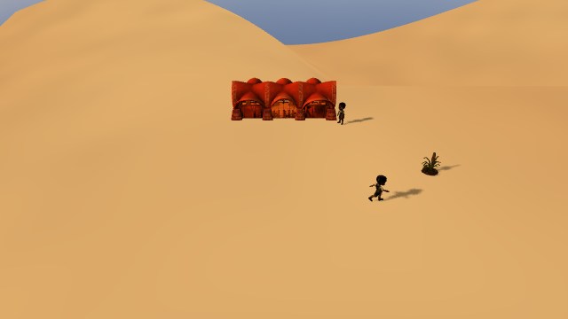
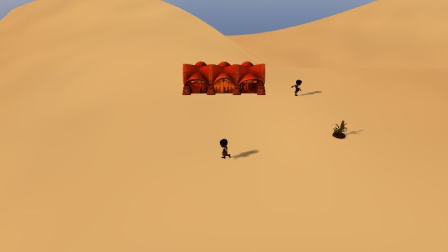

# Home inmediato durante la adopción gráfica de Idle

Continuación de [la transición nativa por fin del contrato](e-r3-native-idle-home-20261116.md), sobre `f0aa9534e`. La misma Surface admite ahora el Home solicitado antes de terminar de adoptar su Idle ya confirmado. No cambia ningún cierre A6/e-R3/e-R4/f-R4/A/B/C.

## Referencias y decisión

Se revisaron las implementaciones reales de `requestMoveTarget`, `resetMoveTarget` y `updateMoveRequest` de [DetourCrowd v1.6.0](https://github.com/recastnavigation/recastnavigation/blob/v1.6.0/DetourCrowd/Source/DetourCrowd.cpp#L573-L777): el nuevo objetivo conserva el agente y separa petición de movimiento ejecutable. También `get`, `getChainMap` y creación/invalidez de `node_modules/three/src/renderers/common/RenderObjects.js`, en Three 0.180.0 instalado: reutiliza el objeto asociado a identidades residentes y comprueba los cambios de estructura al instalar o invalidar.

Se adapta ese patrón a los propietarios existentes: conservar cuerpo, actor, geometrías y lotes; verificar la asociación inmutable al recibir/instalar; preparar sólo el delta de materiales/movimiento antes del efecto físico. No se añade otro renderer, cola, controlador ni dependencia. El espejo existente lee la identidad de la prueba instalada y la secuencia vigente durante reproducción, sin volver a recorrer la pose inmutable en cada dibujo.

## Relevo

La espera de publicación de Idle en Surface admite `returning` con `pending-home-resources` sólo si ya está confirmada la entrega y permanecen exactamente pose, orientación, fases y presupuesto del Idle. Exige ausencia de tarea/caja, movimiento, incapacidad o recuperación. La prueba directa del cuerpo Idle sigue siendo necesaria; una etiqueta de publicación no concede movimiento ni sustituye su autorización. La imagen obsoleta de Carry se drena antes de adoptar el resultado coherente.

La proyección pública del propietario Idle reconoce también su petición Home exacta sobre el mismo cuerpo. Usa la prueba nativa actual y el proyector Home común; conserva su liquidación histórica. El Home posterior utiliza la ruta y los puertos existentes, con rollback, commit condicionado y drenaje real.

## Evidencia

[Registro de validación](performance/native-idle-home-consumer-validation-20261116.json) y [captura GPU completa](performance/native-idle-home-gpu-20261116.json).

- **66/66 pruebas en nueve archivos**, incluida la petición dentro del commit de Idle, controles, transporte y ciclo de vida de Surface. Después se reforzó la lectura explícita del Idle pendiente de Home: **13/13** casos pasan. Con sólo el puente de `f0aa9534e` cargado en memoria, esa lectura reproduce un fallo esperado y doce omisiones. El primer control sin esa lectura explícita pasaba; no se usa como contraejemplo del padre.
- Build del producto correcto en **46,13 s**; los dos módulos nativos permanecen exactamente como en `f0aa9534e`. Los 16 archivos originales protegidos conservan su hash.
- NVIDIA/Turing, recursos y actores originales, desierto mínimo 640×360 y calidad `muy_baja`. Entrega → Idle: **96** creaciones al preparar, **cero** tras READY; acumulado **2694 → 2790 → 2790**, con **53 dibujos** durante el bloqueo posterior de 1,8 s.
- Idle → Home: **98** creaciones al preparar, **cero** tras READY; acumulado **2790 → 2888 → 2888**. Se registran **54 dibujos** del Idle durante el bloqueo inicial de preparación de 1,8 s y **53 dibujos** del Home durante el bloqueo posterior de 1,8 s.
- Actores raíz **680 y 681**, huesos, geometrías originales y lotes del mundo conservados. Selección ordinaria devuelve `worker-900011` en el Idle y en el Home movido. El compañero continúa; se cobra una sola entrega y Home no vuelve a alterar el libro económico.
- Puertos Surface/recursos/control y `queue.onSubmittedWorkDone()` reales; retirada final drenada. Cero errores GPU, página, consola, HTTP o peticiones fallidas. Ambas imágenes finales se inspeccionaron y copiaron sin modificar.

La primera ejecución hardware ya pasó recursos, identidades, selección y drenaje. Se repitió después de añadir la cuenta explícita de dibujos durante el bloqueo inicial de Home; las cifras anteriores proceden únicamente de esa ejecución final.

## Límites y siguiente punto

El origen sigue en la página y B es la intención Home heredada independiente del laboratorio. La transición invoca el mismo método de política que usa Game, pero este escenario mixto no acredita una cohorte completa de `Game.tick`; el cruce horario real de Game se prueba en ambos WASM en el incremento anterior. No se afirma ausencia de cualquier pausa del controlador ni aceptación de la partida integrada.

Siguen pendientes Idle inicial y su admisión estacionaria nueva, vencimientos/cancelaciones de otras tareas, puertas, productor ordinario, sustitución de una partida viva y recuperación incremental integral de los 3123 recursos sanos. La llegada Home y la restauración nueva tienen evidencia en sus incrementos propios; no se repiten aquí. Continúa A → B → C → D.
