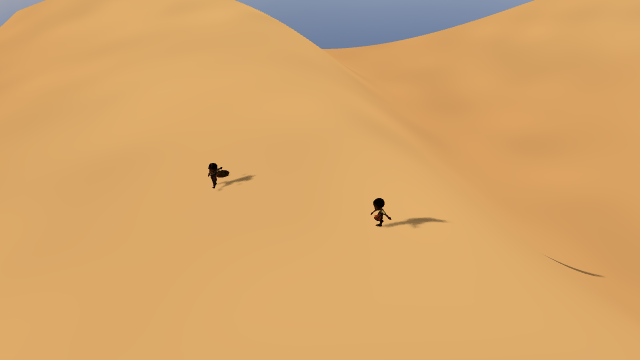

# Paseo Idle preparado en Surface y GPU sobre el actor residente

Continúa la [vista ejecutada 22 de Game](e-r3-native-idle-stroll-live-game-20261116.md). El paseo genuino ya cruza el preparador y consumidor originales, con adopción de la publicación actual comprobada en NVIDIA/Turing. El tick ordinario, los relevos desde un paseo y su restauración siguen pendientes; no cambia ningún cierre A6/e-R3/e-R4/f-R4/A/B/C.

## Referencia de implementación

Antes de extender el consumidor se leyó el código real de [Godot 4.3 `RenderingDevice::_begin_frame` y `_free_pending_resources`](https://github.com/godotengine/godot/blob/4.3-stable/servers/rendering/rendering_device.cpp): espera el fence antes de liberar recursos pendientes en orden de dependencias. Se conserva el mecanismo existente de paquete preparado, retención/adopción de publicación y retirada diferida. Los bancos/variantes y kernel finito siguen las revisiones reales de Three de los incrementos anteriores. No se introduce otro renderer, cola, caché global ni dependencia.

## Preparación, adopción y reloj

Surface incorpora su proposal, template, recibo y recursos confirmados propios al preparador común. Usa el soporte visible de terreno y el método de paseo del roster residente; renovación y cancelación siguen los propietarios anteriores. El paquete exige el reloj relativo 22 y picking desde el float efectivamente enviado. El consumidor anuncia `nativeIdleStrollVersion:1` para esta adquisición preparada; un bootstrap histórico activo continúa rechazado.

La adopción espera una secuencia de publicación nueva que contenga la vista WALK realmente ejecutada, el mismo actor/perfil/centro, ancla, destino y RNG. No se compara una pose inicial inmóvil con un cuerpo que ya está andando ni se concede la fase a partir del deseo anterior. El lookup de origen de puertas incluye la asociación 22 actual y sus IDs atestados, reutilizando el mismo control de sesión/secuencia/handle; la aceptación integrada de cruces con puertas sigue pendiente.

El harness existente admite una opción de paseo después del ciclo 21. La fuente decide WALK con su secuencia privada; el preparador solicita recursos una vez, drena y adquiere la referencia exacta. Usa `projectNativeIdleStroll` y el transporte vivo para publicar Game. La bomba explícita del fixture no es el scheduler ordinario ni el tick completo, que permanece cerrado para esta clase.

## Recursos y hardware

[Recibo GPU completo](performance/native-idle-stroll-surface-gpu-20261116.json), [validación y hashes](performance/native-idle-stroll-surface-validation-20261116.json).

- NVIDIA/Turing, desierto mínimo de 640×360 y calidad `muy_baja`, nueve sectores y dos actores originales. Fuente WASM, puertos, preparador, Surface y Host reales; no recibo de GPU simulado.
- El paseo conserva **577 IDs vivos de buffers de geometría y texturas** anteriores, actor/raíz/huesos/índices/instancias. No se copian buffers estáticos ni texturas nativas residentes.
- **98 recursos de protocolo durante preparación**, incluyendo la textura nueva de datos de la trayectoria, sampler y programas del primer grafo móvil. **Cero después de READY.** Se contabilizan aparte **26 copias nativas de uniformes / 4864 bytes y 26 bindings dependientes** durante preparación, también cero después de READY. Los IDs del protocolo no se confunden con esas asignaciones.
- Durante los bloqueos de 1,8 s hay **54 dibujos con la fase anterior** y **53 con el paseo adquirido**, mientras el compañero avanza por su corredor. La selección ordinaria alcanza ambos actores usando el checkpoint de watermark retenido; no mide clic sobre un objetivo que continúa moviéndose.
- Surface vuelve a **`ready`**, adoptando publicación **3 → 4**. Pasan runtime/GPU/consola/HTTP, ausencia de nuevas factories/forks tras READY y retirada drenada.

Se revisó visualmente la captura: ambos modelos originales y sus sombras son visibles. Esto no es una campaña C, una medida global de tirones ni la recuperación de los 3123 recursos sanos. El siguiente paseo repetido todavía requiere la fuente nativa de descanso posterior; no se inventa un segundo ciclo sobre la pose original para medir reutilización de pipelines.

## Comprobaciones de ingeniería y continuación

**519/519 pruebas enfocadas en 48 archivos**, 274542.3048 ms, incluyendo todas las familias gráficas y vistas Game previas, guards de control/puertas/canales, transporte/persistencia y Surface. **Build correcto en 48.92 s.** Las 57 entradas comprobadas permanecen idénticas durante GPU/regresión/build. Las 17 entradas nativas, 16 archivos locales ajenos protegidos y helper pthread original no cambian; no se recompila WASM.

El siguiente punto es la fuente estacionaria auténtica y el descanso tras el paseo, junto con tarea/Home sobre su pose actual y restauración semántica nueva. El cuerpo actual debe conservarse; su antiguo origen 20 no puede sustituir al extremo caminado. Después siguen aproximación/anclas/bloqueo, cohorte y productor ordinarios, otras clases/finales/puertas, nacimiento/sustitución en vivo, recuperación incremental integral de 3123 recursos sanos y cierres A6/A/B/C. No se inicia D.
