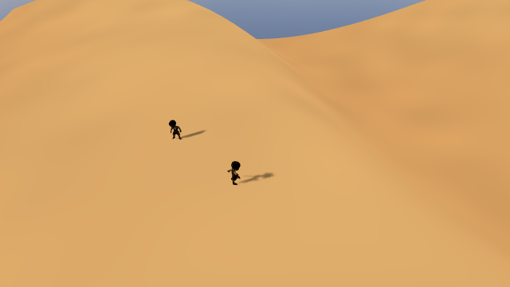
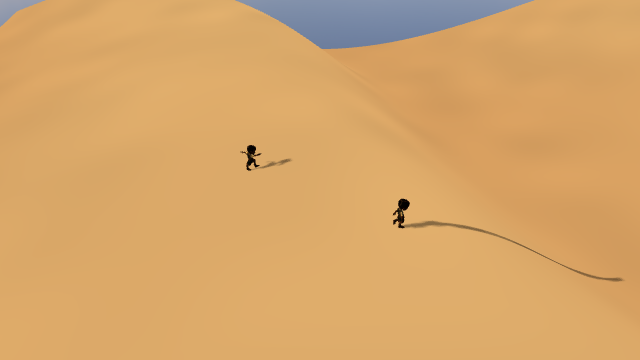

# Consumidor preparado del cuerpo Idle inicial

Continúa la [fuente nativa del cuerpo inicial](e-r3-native-initial-idle-body-source-20261116.md) y [su asociación en el control existente](e-r3-native-initial-idle-body-control-20261116.md), sobre `4b687dc2d`. Se completa la admisión preparada de un descanso o vigilancia ya inicializados, con su pose y fase privada retenidas. La ejecución de la política completa de Idle sigue pendiente. No cambia ningún cierre A6/e-R3/e-R4/f-R4/A/B/C.

## Referencias y adaptación

Se consultó el código real instalado de Three 0.180.0: [Pipelines.getForRender](https://github.com/mrdoob/three.js/blob/r180/src/renderers/common/Pipelines.js) conserva programas y pipelines por sus claves, cuenta sus referencias y recoge las promesas de compilación pendientes. Se mantiene ese patrón: preparar el delta de movimiento/materiales y conservar las identidades residentes antes de confirmar el efecto físico.

También se revisó [AnimationMixer.clipAction](https://github.com/mrdoob/three.js/blob/r180/src/animation/AnimationMixer.js): busca por clip y raíz y reutiliza enlaces conocidos. El relevo Home desde Alert selecciona explícitamente la base Walk ya residente mediante nuestra variante existente, conservando los bancos de fase y permitiendo rollback. La prueba hardware detectó que el selector anterior sólo infería Walk/Run activos; se añadió un caso dirigido de Home desde vigilancia para cubrirlo.

Se contrastaron asimismo el transformador estacionario y el grafo nativo de acción ya existentes con `worker-actions.js`: descanso y vigilancia originales usan `idleState.elapsed`, no el tiempo global. La nueva presentación retiene esa fase, reduce el módulo en doble precisión antes de convertir a float32 y conserva la procedencia del reloj nativo en color, sombra y selección. No inventa una acción Repair, una duración Idle nula, una tarea anterior, Carry ni liquidación. No se añade dependencia, controlador, registro de actores ni reloj.

## Admisión y relevo

La familia 20 utiliza el transactor común: propuesta real, preparación por puerto dedicado, drenaje del paquete anterior, revalidación nativa, commit físico condicionado, retención y publicación. El receptor, cliente, Host y Surface exigen la plantilla y asociación de esta familia, sesión, secuencia, cuerpo y frontera exactos. La preparación sola no concede permiso. Se anuncia `nativeInitialIdleBodyVersion:1` para esta admisión; se mantiene el rechazo del bootstrap histórico activo.

El roster prepara ambos clips originales Idle/Alert sobre el actor inicial sin historial y conserva sus mallas, huesos y geometrías. La preparación usa la exclusión existente para impedir que una instalación ordinaria concurrente cambie los materiales candidatos. Terrain aporta el apoyo estacionario real. La selección consume el mismo float relativo enviado al dibujo, con el origen real de la adquisición, incluso si otro trabajador avanza mientras se prepara o drena.

Una petición genuina de tarea o Home puede producirse antes de que Surface termine de adoptar el cuerpo confirmado. Debe conservar exactamente su cuerpo, pose, fases y presupuesto. Task14/Home18 preparan su sucesor con los mecanismos existentes y revocan el permiso retenido al adquirir movimiento. Se conserva rollback de materiales y enlaces; no se sustituyen actor ni geometrías. Home no fabrica una liquidación anterior.

## Evidencia

Resultados completos de pruebas, build, preservación y referencias en [la validación](performance/native-initial-idle-body-consumer-validation-20261116.json).

- **33/33 pruebas dirigidas**: puertos reales y fuente WASM, fase original y selección, shaders color/sombra de Three, cuatro perfiles por descanso/vigilancia, skinning frente a los assets originales, Task/Home, rollback, cancelación, cambio semántico y espera de drenaje mientras el compañero avanza. Las colas GPU de estos tests son simuladas; la evidencia hardware siguiente es independiente.
- [Vigilancia, GPU real](performance/native-initial-idle-body-watch-gpu-20261116.json): NVIDIA/Turing, **2014 → 2112 → 2112** recursos acumulados; **98** al preparar y **cero** tras READY. Se registran **54** dibujos durante el bloqueo inicial de preparación de 1,8 s y **53** posteriores.
- [Descanso, GPU real](performance/native-initial-idle-body-rest-gpu-20261116.json): los mismos **98/0** y acumulados, con **54/54** dibujos durante ambos bloqueos.
- [Home inmediato desde vigilancia, GPU real](performance/native-initial-idle-body-home-gpu-20261116.json): la petición se emite dentro del callback de commit del cuerpo20, antes de su adopción en Surface. El cuerpo inicial conserva **98/0**; Home prepara otros **98** recursos y crea **cero** tras READY, con **54/54** dibujos en sus bloqueos. Actor, huesos, geometrías y lotes conservan identidad; READY y adopción conservan también todos los propietarios de recursos.
- Las tres ejecuciones hardware usan Surface, renderer, puertos de recursos/control y `queue.onSubmittedWorkDone()` reales. Selección ordinaria del cuerpo inicial y Home, progreso independiente, retirada drenada y cero errores GPU, página, consola, HTTP o peticiones fallidas. Las dos imágenes siguientes se inspeccionaron y copiaron sin modificar.

El escenario hardware es un checkpoint inicializado explícito, desierto mínimo 640×360, calidad `muy_baja`, nueve sectores cargados y dos actores originales. Para el relevo Home se declara su entrada sobre el corredor despejado comprobado antes de crear la autoridad de intenciones: el pueblo real de ese checkpoint está fuera de los sectores cargados. No se presenta como aceptación de streaming o entrada ordinaria del pueblo. El primer intento rechazado por destino desconocido permitió identificar ese límite; el siguiente detectó el defecto real del selector Alert corregido arriba.

Los dos módulos nativos y sus fuentes compiladas permanecen sin cambios; los 16 archivos locales originales protegidos conservan sus bytes. El build y la regresión de los protocolos compartidos se detallan en la validación enlazada.

Siguen abiertos la inicialización y política completa de Idle/Alert/paseo con RNG/ancla originales, productor ordinario, otras clases/finales y puertas, nacimiento en vivo, sustitución de partida y recuperación incremental de los 3123 recursos sanos. Los 98 recursos del delta de este actor no demuestran todavía la recuperación integral ni ausencia absoluta de tirones. El siguiente trabajo continúa esa política dentro de la autoridad y reloj existentes, precedido por consulta de implementaciones contrastadas.
