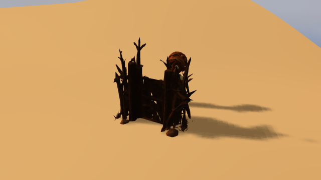
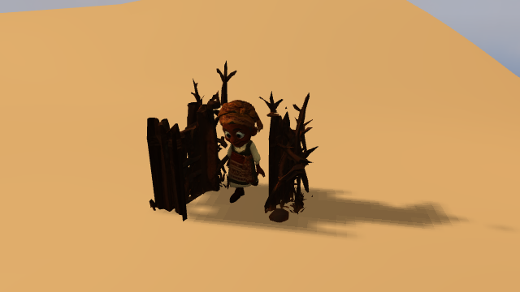

# f-R4 parcial: puerta original y trabajador bajo el mismo tiempo nativo

Fecha: 2026-11-14. Base: `0f947f952`. Rama: `codex/guardian-3d-animation`.
Continúa el [plan](integrated-gpu-migration-plan-20261104.md), la
[corrección A6](intent-route-architecture-correction-20261108.md) y el
[reloj de selección por asignación](f-r4-native-input-clock-20261114.md).
Los once padres A6 y e-R3/e-R4/f-R4 siguen abiertos.

## Implementación y propietarios

La captura de ruta incorpora ahora las puertas que realmente reserva C++.
Dos lecturas nativas comprueban sesión/slot/generación, admisión, reserva y prueba
estática vigente; copian identificador de mecanismo, raíz, bisagra y todos los
nudos de apertura dentro del intervalo de la ruta. `gateMotionKnots/gateOpening`
siguen siendo los únicos propietarios del motor, incluido su cierre previo y
reversión futura. Las lecturas no alteran reloj, intenciones, cuerpos o motor.
Los datos copiados se validan al transferirlos, sin conceder autoridad.

WorldSurface pide al roster existente preparar el trabajador y a Settlements
preparar las hojas en sus propietarios normales de muros. Todos participan en
`prepareManyAndPublish`, que ya existía: reúne los tickets y después publica el
grupo. Cada propietario valida de nuevo su geometría, colocación y posesión.
Las puertas se activan antes del actor; un fallo revierte las anteriores y deja
el actor sin publicar. Un muro que cambie durante la espera cancela el grupo.
Los materiales anteriores se retiran con el fence de admisión existente.
Al confirmar el relevo se sueltan las referencias de staging al enlace anterior;
la hoja retiene el nodo de tiempo, no el objeto completo de movimiento del actor.

NativeWall conserva su malla, geometría, color y UV originales. Sus entradas
inmutables de posición/normal/máscara se declaran desde la primera admisión;
incorporarlas durante una preparación cambiaría la clave de geometría visible.
La variante usa esos atributos, una tabla de seis `vec2` y el nodo de tiempo
finito de la asignación. Three gira posiciones y normales en el shader. La
colocación global debe coincidir con la matriz nativa, también bajo su grupo de
asentamiento; no se vuelve a aplicar la raíz como matriz local.

El muro enlazado no articula ni sube vértices en cada publicación. Rechaza una
transición de geometría/salud que no haya pasado por su propietario de relevo.
La entrada usa un proxy CPU que consulta el tiempo realmente presentado y aplica
el mismo giro a los vértices originales. El proxy comparte geometría sin estar
en la escena de dibujo. Una caja conservadora cubre marco y todo el radio de
giro, tanto para culling como para el rechazo previo de rayos de Three.
La interfaz CPU de pose nativa y esta variante GPU se excluyen mutuamente.

La residencia de la hoja pertenece al muro, de modo que liberar los recursos
gráficos del trabajador no destruye la puerta. WorldSurface incluye las hojas
residentes al calcular cobertura de reloj y capturar tiempos de selección.
El testigo de tiempo sigue siendo una referencia nativa validada; no se retaga
un uniform viejo para reutilizarlo en otra asignación.

## Código fuente consultado y decisión

Se inspeccionó Three r180, revisión de la dependencia utilizada:

- [RotateNode.js](https://github.com/mrdoob/three.js/blob/r180/src/nodes/utils/RotateNode.js):
  matrices de rotación TSL. Se usa `rotate` en los atributos originales; su signo
  Y se contrasta con `gateLeafMatrix` de C++ y el raycast usa el giro equivalente.
- [Mesh.js](https://github.com/mrdoob/three.js/blob/r180/src/objects/Mesh.js) y
  [SkinnedMesh.js](https://github.com/mrdoob/three.js/blob/r180/src/objects/SkinnedMesh.js):
  el raycast consulta `getVertexPosition`; los límites se comprueban antes de las
  intersecciones. Se adapta el mismo punto de extensión en un proxy de entrada.
- [Box3.js](https://github.com/mrdoob/three.js/blob/r180/src/math/Box3.js):
  acumulación de límites y esfera derivada. Se reutilizan para el barrido
  conservador, sin otro índice espacial o sistema de colisiones.
- [UniformArrayNode.js](https://github.com/mrdoob/three.js/blob/r180/src/nodes/accessors/UniformArrayNode.js),
  [UniformNode.js](https://github.com/mrdoob/three.js/blob/r180/src/nodes/core/UniformNode.js) y
  [WGSLNodeBuilder.js](https://github.com/mrdoob/three.js/blob/r180/src/renderers/webgpu/nodes/WGSLNodeBuilder.js):
  disposición acolchada de arrays y nombre de buffer por defecto basado en un
  identificador. Comparar WGSL reales mostró dos shaders/pipelines nuevos solo
  por ese nombre en un relevo. La API `setName('nativeGateKnots')` mantiene estable
  la interfaz; cada material conserva su propio buffer y sus datos. Tras aplicarla,
  el mismo relevo crea cero shaders/pipelines. No requiere parche adicional.

Se extienden los propietarios y la admisión existentes. No se añaden dependencias,
renderers, Workers, planificadores o relojes autoritativos.

## Validación y evidencia

[Registro de validación](performance/native-gate-graphics-validation-20261114.json).
Las pruebas de geometría consultan C++ durante cierre/reapertura para zarzas,
empalizada y reforzado, con yaw y grupos anidados. Contrastan aperturas y rayos
sobre triángulos físicos, conservando arrays/versiones. También cubren captura
de varias puertas, identidad, copias, cambios de colocación, fallo de activación,
reintento y cambio de curva sin nueva asignación. Las dos variantes WASM compilan;
la variante con hilos carga y expone el ABI de captura.
Pasan 41 pruebas dirigidas; las seis de geometría se vuelven a verificar con yaw,
exclusión CPU/GPU y confirmación del relevo. La regresión de 132 archivos registra
1.469 casos: 1.467 aprobados, los mismos dos fallos heredados Carry/Harvest y cero
omisiones. Build aprobado en 46,21 s y 308 scripts comprobados sin errores.

La prueba con WorldClient/Worker/Surface/roster/Settlements normales y NVIDIA
Turing incluye ahora la puerta original como malla animada, además del personaje:
[Walk/Idle](performance/native-worker-drawn-gate-20261114.json) y
[Carry](performance/native-worker-drawn-gate-carry-20261114.json). Cada una conserva
15 dibujos durante 500 ms de bloqueo de preparación, apertura nativa 0 → 1,
identidades y atributos CPU intactos, reutilización completa de la misma
asignación y cero fábricas GPU en el primer render preparado. El relevo retiene
shaders/pipelines y geometrías; requiere los buffers de datos/bindings nuevos
registrados en el recibo. No se presenta como cero asignaciones de recursos.
La selección normal alcanza actor y puerta, también después de liberar los
recursos gráficos del actor. El cierre espera el drenaje del consumidor real.

Estado inicial y tras la apertura:

## Límites y siguiente pendiente

La prueba entrega explícitamente una ruta admitida y pausa el reloj durante su
preparación. La liberación comprobada es de recursos gráficos; la intención C++
permanece vigente en esa comprobación. No acredita la retirada lógica de la última
asignación, un cierre posterior sin actores, ni toda la coordinación antes del
efecto físico. La clase gráfica cubre los tres mecanismos nativos de malla íntegra,
salud completa y apoyo plano; no amplía los estados/materiales admitidos en C++.

El siguiente punto es llevar las propuestas del motor y sus relevos/retiradas al
protocolo común de preparación y commit condicionado. En particular,
`prepareNativeGateMotionAfterGpuFence` todavía usa el fence anterior y no recibe
recursos gráficos preparados. Hay que coordinar también la retirada lógica y el
motor sin asignaciones, manteniendo referencias/relojes válidos antes de avanzar
o publicar el efecto. Después siguen productor/ejecutor ordinarios, persistencia
de fases, acciones/consecuencias, todas las intenciones e integración A–F/B/C.
No se retiran los movers JS protegidos ni se declara autonomía de producto o
ausencia completa de tirones con estas pruebas.
