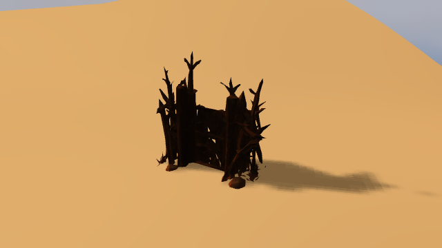

# f-R4 parcial: comandos retenidos antes del commit físico

Fecha: 2026-11-14. Base: `5da7441a3`. Rama: `codex/guardian-3d-animation`.
Continúa el [plan integrado](integrated-gpu-migration-plan-20261104.md) y el
[motor preparado independiente del actor](f-r4-prepared-gate-motor-20261114.md).
Los once padres A6 y e-R3/e-R4/f-R4 siguen abiertos.

Continúa con [comandos preparados de terreno y props](f-r4-prepared-terrain-commands-20261114.md); los cierres globales siguen pendientes.

## Cambio efectivo

El consumidor conserva ahora el paquete de dibujo del mundo propuesto antes
del efecto físico. Extiende la admisión existente con `prepare-world-frame`
versión 1: valida comandos, espera recursos, separa las generaciones que reciben
uploads y acredita su envío mediante el fence real. Mientras tanto sigue
dibujando el paquete anterior. El candidato conserva su instantánea de recursos,
relojes y cámara; retagar el buffer lógico después no cambia esa instantánea.

La preparación no autoriza una imagen futura. El release del canal nativo
debe confirmar exactamente autoridad, sesión, ticket y tiempo del candidato.
Solo entonces el consumidor lo adopta, revalida las referencias nativas y aplica
el reloj causal directo. No necesita otro turno del preparador ni otro paquete.
Los command buffers WebGPU se siguen codificando de nuevo para cada submit;
lo que se retiene es la descripción de comandos y sus recursos, no un objeto
nativo que WebGPU solo permite enviar una vez.

El recibo de quiescencia puede exigir el candidato de esa frontera. Cada miembro
del cohort comprueba que todavía lo retiene y que terminó sus uploads. El ACK
devuelve también su secuencia de frame. Un peer antiguo o un paquete cancelado
antes del recibo no permiten el efecto físico, aunque el handle del llamador
parezca válido. El recibo retiene el candidato hasta release; una cancelación
tardía del productor no puede retirarlo entre el ACK y el cambio de mundo.
El marcador confirmado debe coincidir también con el exigido en ese recibo.

WorldSurface usa su mismo kernel de render para grabar el candidato de puerta,
después de los tickets de materiales y antes de responder «listo». Conserva los
participantes activados para poder revertirlos si se aborta. Los tickets de
alternativas se consumen al activar/grabar; desde ahí la disponibilidad la
acredita el paquete retenido en el consumidor. El commit posterior finaliza
los propietarios y la entrada queda retenida hasta el ACK del dibujo real.

`minSequence` permite esperar la publicación estructural correspondiente antes
de grabar. Usa el callback de confirmación existente y un wait cancelable con
plazo de 10 s; no consulta posiciones periódicamente. El cliente rechaza una
respuesta antigua que solo acredite materiales, sin paquete preparado.
El bridge exige también esa prueba para el motor causal y rechaza un publicador
que devuelve únicamente drenaje sin el candidato de comandos exigido.

## Recursos y orden de las operaciones

La retención de un frame obsoleto podía incluir una subida de textura del rig.
Completar únicamente sus uniformes no bastaba para el fence de admisión siguiente.
La copia al escribir existente se extiende a texturas de color 2D copiables,
conservando todos sus mips y capas. Se reconstruyen sus vistas y bind groups
inmutables; el paquete visible conserva los anteriores. Se copian solo los
destinos de uploads retenidos que lo necesitan. No se reconstruyen el catálogo,
las geometrías, los shaders ni los pipelines sin cambios.

Los uploads se completan antes del efecto. Los comandos de dibujo conservan su
orden; las copias de recurso de primer submit no se descartan como si fueran
replay. Se rechazan cómputo de un solo uso, mezcla de uploads CPU con salidas GPU,
sobrescrituras GPU de los relojes de presentación y preparación de texturas
dependiente de un draw previo. Un paquete de solo uploads no acredita una imagen.
Las clases sin contrato de repetición o de versión siguen fallando de forma segura.

## Implementaciones consultadas

- Godot **4.5.1-stable**, [RenderingServerDefault](https://github.com/godotengine/godot/blob/4.5.1-stable/servers/rendering/rendering_server_default.cpp)
  y [CommandQueueMT](https://github.com/godotengine/godot/blob/4.5.1-stable/core/templates/command_queue_mt.h):
  el servidor gráfico posee la ejecución; `draw` encola argumentos poseídos y
  `sync` delimita lo ya procesado. Se adapta al consumidor y a su recibo directo,
  conservando el cohort y el protocolo de mutaciones existentes.
- wgpu **v26.0.1**, [CommandBuffer](https://github.com/gfx-rs/wgpu/blob/v26.0.1/wgpu/src/api/command_buffer.rs),
  [Queue::submit](https://github.com/gfx-rs/wgpu/blob/v26.0.1/wgpu/src/api/queue.rs) y
  [StagingBelt](https://github.com/gfx-rs/wgpu/blob/v26.0.1/wgpu/src/util/belt.rs):
  grabación, envío y recuperación son etapas diferentes; submit consume los
  buffers de comandos. Aquí el ACK de preparación acredita uploads enviados,
  sin convertirlo en ACK de imagen ni reutilizar buffers nativos consumidos.
- Three **r180**, [WebGPUTextureUtils](https://github.com/mrdoob/three.js/blob/r180/src/renderers/webgpu/utils/WebGPUTextureUtils.js)
  y [WebGPUBackend.copyTextureToTexture](https://github.com/mrdoob/three.js/blob/r180/src/renderers/webgpu/WebGPUBackend.js):
  reserva `COPY_SRC/COPY_DST` en las texturas normales y codifica origen, nivel
  y extensión para copiar. Se reutiliza esa disposición para separar versiones
  y reconstruir sus vistas, sin sombra CPU completa de cada textura.

No se añade ninguna dependencia, Worker, autoridad, bus de control o planificador.

## Evidencia y límites

[Recibo de validación](performance/native-prepared-world-validation-20261114.json).
Pasan 200 pruebas dirigidas. La regresión ampliada de 135 archivos registra
1.517 casos: 1.515 aprobados, los dos fallos heredados Carry/Harvest y cero
omisiones. Build aprobado en 43,22 s; 308 scripts QA y los 16 módulos cambiados
comprobados sin errores de sintaxis. Se reutilizan los binarios WASM exactos
de la base validada; no hay cambios C++ ni de ABI en este incremento.
Las pruebas verifican preparación sin efecto ni imagen futura; integridad del
último buffer/textura visible; mips, capas y regiones parciales; fence real;
cancelación antes y después del recibo; retiro del consumidor; referencias de
reloj inmutables; rechazo de asignaciones no autorizadas y replies antiguos;
copias de primer submit y exigencia de prueba preparada en el cohort.

Los recibos [Walk/Idle](performance/native-worker-prepared-cutover-20261114.json)
y [Carry](performance/native-worker-prepared-cutover-carry-20261114.json) ejercitan
los propietarios normales y C++ real en el fixture. Conservan la prueba inicial
de 500 ms. Para el corte, detienen el preparador **1.500 ms después de «listo» y
antes del commit**, cambiando el mundo durante ese bloqueo. El consumidor dibuja
el marcador nuevo y cierra la hoja con cero trabajadores nativos, sin otro
paquete ni publicaciones de posición. La captura de píxeles termina dentro del
bloqueo, no después de que el preparador despierte. Los recibos incluyen los
tiempos, las secuencias y el delta de recursos, incluidas las copias internas.

Se mantienen malla y atributos originales; la primera grabación de la variante
no crea recursos y no hay shaders/pipelines nuevos. Esto no significa cero
asignaciones de datos: hay buffers, vistas o copias de textura preparados antes
del efecto. El cierre del cliente espera el drenaje real del consumidor.

La [prueba de datos en GPU nativa](performance/native-texture-versioning-20261114.json)
usa el mismo host con una textura `rgba32float`, dos mips, dos capas y una región
parcial. La lectura GPU conserva los texels anteriores, el mip no modificado y
confirma el color esperado del dibujo con el bind group/vista nuevos. Este caso
usa un peer de control sintético: valida la copia y sus enlaces, no la autoridad
física ni una partida. Los cortes de puerta finales registran 17 recursos nuevos
del productor preparados antes del efecto y ningún fork de textura en esos dos
recibos; el caso dedicado acredita por separado la rama que sí lo necesita.

La autoridad C++ del fixture pausa durante la preparación y avanza durante el
bloqueo mediante el mismo reloj causal. No prueba todavía el productor/ejecutor
ordinario en el Worker autoritativo, la preparación de nuevas asignaciones aún
no admitidas, la retirada lógica transaccional, todas las familias de mutación,
consecuencias, persistencia/restauración ni la aceptación A/B/C. Tampoco certifica
todos los formatos de textura, todos los efectos o toda la reproducción temporal.
El cohort exige un paquete a cada consumidor cuando se solicita esta garantía;
no se ha validado el corte visual positivo de varios consumidores simultáneos.

Siguiente dependencia: llevar la misma preparación de comandos a las demás
mutaciones y al relevo nativo de entidades/asignaciones, conectándolo al feed
ordinario y sus consecuencias antes de activar autonomía de producto.
