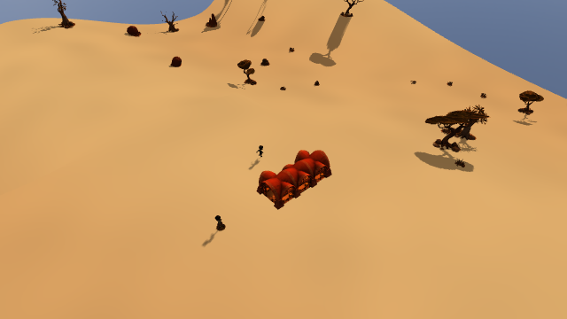

# Farm → aproximación → Idle en Surface/GPU

Continúa la [fase Idle de Stroll](native-idle-stroll-idle-phase-20261118.md), el [transporte vivo](native-farm-idle-approach-live-state-20261118.md) y el [plan integrado](integrated-gpu-migration-plan-20261104.md). La sonda ejecuta23 →22 →21 sin20/24 ficticios y conserva el actor original. A6/A/B/C abiertos; D no iniciado.

## Recorrido y decisiones

La fixture declara una planta viva manual fuera del extremo Farm antes de crear la autoridad. Usa los protocolos22/21, las plantillas retenidas, Surface, actor, puertos y Host existentes. Game conserva Farm hasta adquirir22; la caminata nativa mantiene el destino ancla y el descanso de nacimiento hasta su llegada. Sólo entonces se prepara y adquiere REST21 y después WATCH. El compañero Home es una fixture independiente declarada; no se presenta como productor ordinario ni aceptación del cohort completo.

Se reutiliza la auditoría estacionaria con fuente Farm/Stroll explícita, secuencias de publicación y bloqueos parametrizados. No se crea un controlador, evaluador de movimiento, reproductor de fases o cola alternativos. Las decisiones de código contrastado están documentadas en las dos correcciones previas: sincronizar propietario vivo frente a crearlo (Godot4.4) y separar acción finita de clip repetitivo (Three r180).

El primer ancla del ensayo coincidía con el edificio y no proporcionaba el recorrido accesible requerido; el ancla exterior alcanza22. Después se detectaron y corrigieron dos problemas reales: el transporte vivo usaba el lector frío y el Idle terminal22 carecía de reloj continuo. Se conservan los ensayos fallidos; no se modifica el runtime para ocultarlos.

## Identidad física y continuidad

Timing y visual conservan650 IDs GPU inmutables de geometrías/bancos, raíz, mallas, índices, rig e instancias.22 prepara70 recursos y21 prepara98; ninguno se crea después de READY. Se sustituye una sola textura de movimiento Farm por la de22 y se retira la de22 al adquirir21. No se reconstruyen buffers de geometría, se copian bancos residentes ni se duplican fuentes de shaders. El banco Alert que aún no estaba preparado puede incorporarse antes de READY; no representa reconstruir un banco existente.

Los bloqueos de1.8s acreditan54 dibujos antes y después de adquirir22 y21. Al llegar22, su reloj físico permanece fijo e Idle avanza con el reloj causal; error de fase3.67e-7/8.63e-7s. La vigilancia mantiene150 dibujos con el preparador bloqueado5s. El picker utiliza los clocks realmente enviados para el actor y su compañero; adopción8, ACK tipados, quiescencia y drain final pasan. El perfil GPU es youngMale en NVIDIA Turing; los cuatro perfiles se prueban en la regresión de código, no en esta ejecución de dispositivo.

## Cadencia y controles

La ventana completa incluye desde el primer bloqueo Farm hasta el último sample tras vigilancia, selección y fence. Timing:1238 frames, máximo46.620ms, p9533.425ms, cero>50ms; global1519, máximo153.720ms y cuatro>50ms. Visual:1248 en la ventana, máximo214.085ms, p9533.425ms y tres>50ms; global1534 y seis>50ms. Se mantienen separadas las capturas y no se atribuye causa a los picos. La cadencia global NO está aceptada; tampoco se cierra la evidencia Home264/147ms ni la validación de plataforma integrada.

El negativo de plantilla21 elimina exactamente un campo en la respuesta de Surface: Host rechaza antes de adquirir21;22 permanece instalado y el cuerpo sigue en el ancla, sin Idle adquirido ni proyección anticipada. Su error de plantilla retenida y exit1 son esperados. La regresión GPU estacionaria Farm23 →21 también pasa con el código compartido ampliado. Sus cifras se conservan en el resultado, sin sustituir las mediciones de la aproximación.

Sintaxis correcta de cinco módulos. Los427 inputs y64 inputs/artefactos nativos coinciden con el congelado de b8faa3593; se mantienen el alcance de2919/2920 pruebas amplias (una comparación opcional omitida),108 dirigidas y build48.20s. No se repite la compilación WASM ni se atribuyen pruebas nuevas al producto por este incremento de auditoría. Los [resultados, controles, hashes y referencias a las trazas](performance/native-farm-idle-approach-surface-validation-20261118.json) delimitan la evidencia.

Se preservan16 archivos ajenos, el worker pthread sin seguimiento y los bytes previos de los cuatro documentos principales. Siguen restauración de aproximaciones, reintentos nativos sin camino, productor/cohort, recuperación incremental integral de3.123 recursos y aceptación global de cadencia/plataforma.
