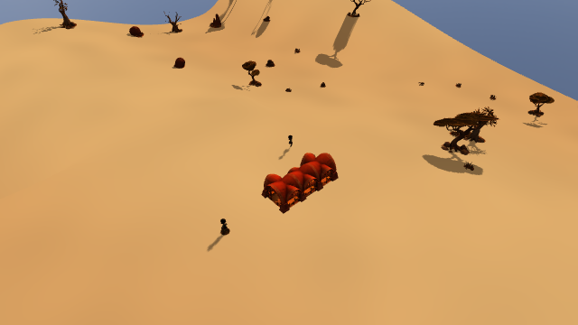

# Aproximación restaurada en Surface/GPU

Continúa el [actor de la aproximación restaurada](native-idle-approach-restoration-graphics-20261118.md) y el [plan integrado](integrated-gpu-migration-plan-20261104.md). Se valida la carga fría y22 → REST21 → WATCH sobre el actor, Surface, puertos y Host originales. A6/A/B/C siguen abiertos; D no iniciado.

## Recorrido y referencias de código

Antes de crear el mundo gráfico, la fixture ejecuta realmente Farm23 y aproximación22. Conserva sólo las semánticas mediante serialize/deserialize públicos, desecha la sesión anterior y crea autoridad, planificador y cuerpo nuevos. La nueva solicitud mantiene approach:true, ancla, nacimiento y RNG; no contiene fuente Farm ni permisos anteriores20/21/24. Se ensayan un checkpoint en movimiento dentro del radio y otro ya llegado. El compañero Home es una fixture independiente y la autoridad vive en la página; esto no acredita el productor ordinario ni el cohort integrado.

Se reutilizan las auditorías de restauración local y de REST21, con la fuente explícita, publicaciones y bloqueos existentes. No se introduce otro controlador, evaluador de movimiento, caché o dependencia. Se consultan las implementaciones reales de [Pipelines de Three r180](https://github.com/mrdoob/three.js/blob/r180/src/renderers/common/Pipelines.js) y [WebGPUBackend](https://github.com/mrdoob/three.js/blob/r180/src/renderers/webgpu/WebGPUBackend.js), además de los archivos instalados cuyos hashes constan en el resultado. Pipelines conserva etapas por fuente y pipelines por clave estructural con recuento de uso; WebGPUBackend crea el módulo desde esa etapa. Se aprovecha esa caché existente y se comprueban las factories físicas, sin crear otra.

## Reutilización y continuidad

Las ejecuciones timing y visual conservan648 IDs inmutables iniciales al adquirir22 y649 al adquirir21, sin recrear buffers de geometría ni duplicar fuentes de shader.22 prepara100 recursos: dos texturas nuevas, doce módulos de shader y ocho pipelines, además de buffers uniformes y bindings.21 prepara98: una textura nueva, doce módulos y ocho pipelines, además de los otros bindings. Los tamaños y referencias físicas de cada textura constan en la traza; el contador de recursos incluye objetos de binding y programas, no sólo recursos gráficos persistentes. Todos se preparan antes de READY; después se crean cero. Al adquirir21 se retira únicamente la textura de movimiento22; los IDs anteriores de geometrías/bancos siguen vivos.

Se conservan actor, raíz, huesos, mallas, geometrías, índices e instancias. Los bloqueos de1.8s mantienen54 dibujos antes y después de adquirir22 y21; vigilancia mantiene150 dibujos durante5s. Selección del actor y compañero con reloj enviado, adopción4, ACK y drain final pasan. En el checkpoint llegado,22 tiene duración cero y no cambia el cuerpo antes del relevo. Esta prueba hardware cubre youngMale/NVIDIA Turing; los cuatro perfiles corresponden a las pruebas de código anteriores.

## Cadencia, controles y alcance

La ventana completa abarca el primer bloqueo22 hasta el último sample retirado tras WATCH/selección/fence: timing674 frames, máximo41.630ms, cero>50ms; visual687, máximo50.560ms, uno>50ms. Global: timing963, máximo76.540ms, tres>50ms; visual972, máximo78.305ms, tres>50ms. No se atribuye causa a los picos ni se acepta cadencia global. Llegado:676 en ventana, máximo47.595ms, cero>50ms; global961, máximo62.130ms y dos>50ms. Se conservan también ambos ensayos iniciales anteriores al refuerzo de la traza, con sus mediciones propias; no se sustituyen por el mejor resultado.

El negativo elimina exactamente una plantilla21 en la respuesta Surface. Host rechaza antes de adquirir21 con exit1 esperado:22 sigue asociado, Game sigue native-idle-stroll y el cuerpo permanece en el ancla. La regresión GPU de la restauración LOCAL también pasa con las nuevas aserciones compartidas; no recibe la marca approach ni ejecuta el nuevo ramal REST.

Sintaxis correcta de cuatro módulos;434 inputs de auditoría y64 inputs/artefactos nativos permanecen iguales al congelado. Producto sin cambios:152 dirigidas,2990/2991 amplias con una comparación opcional omitida y build48.33s pertenecen a ba87ba88a; no se atribuye su ejecución a este incremento QA ni se reconstruye WASM. Los [resultados, trazas, controles, capturas y hashes](performance/native-idle-approach-restoration-surface-validation-20261118.json) delimitan esa evidencia.

Se preservan16 archivos ajenos, el worker pthread sin seguimiento y los bytes anteriores de los cuatro documentos principales. Pendientes: fallo/reintento nativo cuando no existe conector de camino, productor/cohort ordinarios, recuperación incremental del conjunto de3.123 recursos y aceptación de cadencia/plataforma. El guardado fraccionario exterior rechazado por la navegación original y los picos Home264/147ms siguen abiertos. La disponibilidad de guardado en UI no se habilita por esta sonda.
