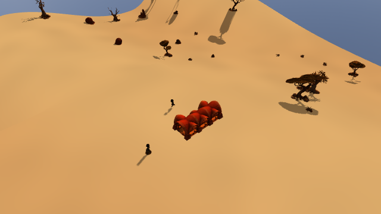

# Continuidad del clip terminal de Idle21

Continúa el [reposo deseado de WALK bloqueado](native-idle-stroll-failed-rest-20261118.md). El clip terminal sigue repitiéndose mientras21 conserva cuerpo y fase privada en su horizonte finito. Un corte anterior por Task/Home conserva su congelación. A6/A/B/C abiertos; D no iniciado.

## Referencia e implementación

Se consulta el código real de [AnimationAction._updateTime, Three r180](https://github.com/mrdoob/three.js/blob/r180/src/animation/AnimationAction.js#L674): LoopOnce limita el tiempo y LoopRepeat aplica módulo al continuar. Se adapta esa distinción reutilizando el transporte de offsets terminales ya empleado por Farm/Stroll, sin otra dependencia, temporizador o propietario.

Cycle sube directamente un float relativo; su offset omite el margen del decoder de movimiento y el origen absoluto que requieren Farm/Stroll. El offset comienza al final del programa completo y usa su origen efectivo, incluidos retarget y adquisición tardía. El cálculo toma el tiempo posterior al extremo para evitar la pérdida por suma/resta en épocas grandes. La cota física, clip seleccionado, pose y RNG permanecen finitos. Los cortes anteriores al extremo no activan la continuación.

El draw owner declara nativeIdleCycleIdlePhaseVersion1. La preparación exige esa capacidad y un reloj relativo físico de la misma referencia; el dato enviado al GPU y el picker se validan juntos. Los offsets se preparan para ambos bancos, se retagean con el grafo y no alteran claves estructurales al cambiar la referencia. La variante conserva actor, geometrías, índices y bancos.

## Validación

Ocho pruebas iniciales reproducen Alert congelado. Pasan23 nuevas y160 dirigidas en11 archivos: cuatro perfiles REST/WATCH, origen tardío, estado/cuerpo/RNG finitos, datos alterados, reloj ausente, capacidad ausente, quiescencia, Home pendiente, épocas grandes y periodos. El builder WGSL real verifica las mismas dos fases tipadas en color/sombra sobre bancos GLB originales. La comparación con skinning CPU mantiene la tolerancia original; sólo el clon del oráculo continúa el clip terminal. El estado de Game sigue limitado por el kernel. La prueba de retag exige ahora reloj relativo, knot y offset del mismo grafo.

El módulo de movimiento anterior, cargado de sólo lectura contra las23 pruebas finales, produce9 fallos esperados y14 aprobadas. La regresión amplia seleccionada de265 archivos termina con3045/3046 aprobadas, cero fallos/cancelaciones y una comparación opcional omitida. Mantiene las siete exclusiones históricas reproducidas; no equivale a todos los tests del repositorio. Build: ✓ built in 48.58s.439 inputs y64 inputs/artefactos nativos coinciden con el congelado; WASM no se reconstruye.

## Surface/GPU y cadencia

Timing y visual recorren carga fría22 → REST21 → WATCH, aguardan el final real y comparan dos frames posteriores. Ambos offsets avanzan con el reloj causal mientras cuerpo, estado semántico y reloj físico siguen fijos. Adopción4, selección, ACK, quiescencia y drain pasan. IDs inmutables conservados: timing647/648, visual648/649; cero creaciones posteriores a READY y cero fuentes de shader duplicadas. La GPU es NVIDIA Turing y el perfil youngMale; los otros perfiles corresponden a pruebas de código.

Ventana completa timing: 738 frames, máximo124.695ms/4>50ms; global1052, máximo124.695ms/6>50ms. Visual: 759 en ventana, máximo51.890ms/1>50ms; global1040, máximo75.820ms/4>50ms. Se conserva la sonda inicial anterior a la corrección del corte anticipado: máximo258.825ms, cuatro>50 en ventana y siete globales. Cadencia global NO aceptada; no se atribuye causa a los picos ni se sustituye un ensayo por el mejor.

El negativo retira exactamente una plantilla21: rechaza antes de adquirir21 y conserva22/cuerpo. Los [resultados, referencias, capturas, controles y hashes](performance/native-idle-cycle-phase-validation-20261118.json) delimitan la evidencia. Se preservan16 archivos ajenos, worker pthread y bytes previos de los cuatro documentos principales.

Siguen pendientes fuente/horizonte/relevo21 del WALK fallido, reintento nativo, productor/cohort, recuperación integral incremental de3.123 recursos y aceptación de cadencia/plataforma. El21 actual sigue exigiendo origen dentro del radio y programa REST/WATCH completo; esta continuación del clip prepara el soporte visual necesario para un futuro horizonte de reintento.
