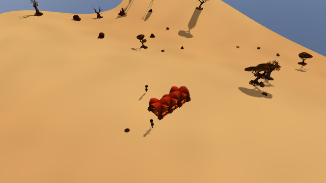

# WALK fallido y reintentos en Surface/GPU — 2026-11-18

Continuación de `8a58e68a8`, dentro de A6-04.f-R3/e-R3. Se conecta una auditoría del primer REST fallido y sus reintentos a Surface, los puertos y el Host originales, con GPU NVIDIA/Turing. Solo cambian auditoría, fixture y driver. El resultado funcional queda probado en este escenario; A6/A/B/C permanecen abiertos y D no se inicia.

## Origen y alcance

El montaje previo ejecuta realmente Farm 23 y aproximación 22, guarda el paseo mediante el formato público y carga una autoridad nueva. El fixture admite progreso nativo 0,2 además del 0,8 anterior, sin recolocar el cuerpo guardado. Su posición queda fuera del ancla. Antes de crear el mundo gráfico se añade una **pared nativa explícita en el destino**, de 0,4×0,4: es un fallo físico de prueba, no la geometría Farm ordinaria. La nueva autoridad conserva la solicitud WALK original y no posee permisos anteriores 20/21/22.

Se mantienen cuerpo, pose, ancla y RNG de la partida. La consulta nativa declara el fallo; el renderer no elige un camino ni fabrica una llegada. Una intención Home independiente sigue avanzando. La autoridad del escenario está en la página; no se presenta como productor/cohort ordinarios, recuperación integral o disponibilidad del guardado en producto.

## Investigación aplicada

Se leyó código de [Three r180, Pipelines.getForRender](https://github.com/mrdoob/three.js/blob/r180/src/renderers/common/Pipelines.js#L151-L225): reutiliza etapas por WGSL y pipelines por clave estructural. La auditoría contrasta fuentes duplicadas e identidad de recursos. También [WebGPUBindingUtils.createBindings/updateBinding](https://github.com/mrdoob/three.js/blob/r180/src/renderers/webgpu/utils/WebGPUBindingUtils.js#L245-L311) conserva layouts por bindingsReference y actualiza buffers mediante queue.writeBuffer; [Bindings._update](https://github.com/mrdoob/three.js/blob/r180/src/renderers/common/Bindings.js#L237-L243) escribe solo uniformes modificados. Estos caminos existentes orientan el siguiente pendiente, sin introducir dependencia o registro paralelo.

## Resultados y pendiente descubierto

- **Timing y visual pasan 15 adquisiciones cada uno**: primer REST desde WALK fallido, sucesores REST y dos WATCH. Las esperas de preparación y post-READY duran 1,8 s en los relevos medidos. El error máximo de continuidad del mismo clip es **2.57492694e-07 s**; se valida el reloj realmente enviado y el picking, con cuerpo fijo y fase nativa finita.
- Conservan **648 IDs inmutables** iniciales, raíces/huesos/mallas/geometrías, instancias y bancos; cero buffers de vértices/índices nuevos, fuentes de shader duplicadas, recursos tardíos o forks posteriores a READY. Selección de ambos actores y retirada de cola pasan. Se revisaron las capturas REST/WATCH: el actor permanece visible y el compañero progresa.
- La primera adquisición prepara **100 recursos** (incluye 12 shaders/8 pipelines genuinos de la familia ausente). **Cada sucesor vuelve a crear 68 objetos: 36 buffers UNIFORM|COPY_DST, 16 layouts y 16 grupos de enlace.** No reconstruye los 3.123 recursos, pero tampoco cumple aún el criterio de reutilizar todo lo que no cambia. Es un pendiente de infraestructura inmediato: conservar identidad/propiedad y actualizar los datos necesarios en los enlaces existentes. No se atribuyen a esas creaciones los picos sin perfilarlos.
- Sin plantilla 21, el control negativo produce exactamente una exclusión, rechaza antes de adquirir y conserva WALK pendiente, cuerpo y ausencia de binding 21. La inspección de limpieza recibe el mismo fallo deliberado del Host; no se reclama un drain positivo para ese negativo.
- La regresión válida anterior 22→21 también pasa: conserva 648/649 IDs inmutables, prepara 100/98 y cero tardíos/duplicados. Cuatro módulos pasan sintaxis; **449 inputs de auditoría, 64 nativos, 16 archivos ajenos y worker pthread exactos**. Sin rebuild WASM ni cambios de producción. Las 346 dirigidas, 3172/3173 amplias y build 46,30 s de `8a58e68a8` conservan su alcance previo; no se presentan como nuevas ejecuciones.
- Cadencia timing: ventana 908 frames, máximo 101.385 ms/17 intervalos >50 ms; global 1197 frames, máximo 101.385 ms/19 >50 ms. Visual: ventana 937 frames, máximo 95.745 ms/17 >50 ms; global 1224 frames/20 >50 ms. **Cadencia no aceptada**, sin causa atribuida.

La primera sonda usaba una propiedad de reloj inexistente y produjo métricas no finitas: se excluye de la aceptación de continuidad. Se corrigió para usar nativeRouteFrame.clockElapsed y rechazar NaN/Infinity. Sus picos (151,965 ms y 22 globales >50 ms), la sonda intermedia y todas las muestras de las capturas finales quedan conservados, sin seleccionar solo la ejecución más favorable.

[Referencias, hashes, recibos, creaciones y muestras completas de cadencia](performance/native-idle-failed-cycle-surface-validation-20261118.json).

## Siguiente punto

Reutilizar uniformes/layouts/grupos en los relevos 21 de la misma estructura, siguiendo los caminos consolidados de identidad y actualización de Three, y medir de nuevo cadencia y transacciones. Después continúan aproximación 22 con remaining, REST/WATCH exterior guardado desde cuerpo inicial genuino, productor/cohort, recuperación incremental de los 3.123 recursos y aceptación de plataforma. Ningún gate integral se cierra aquí.
