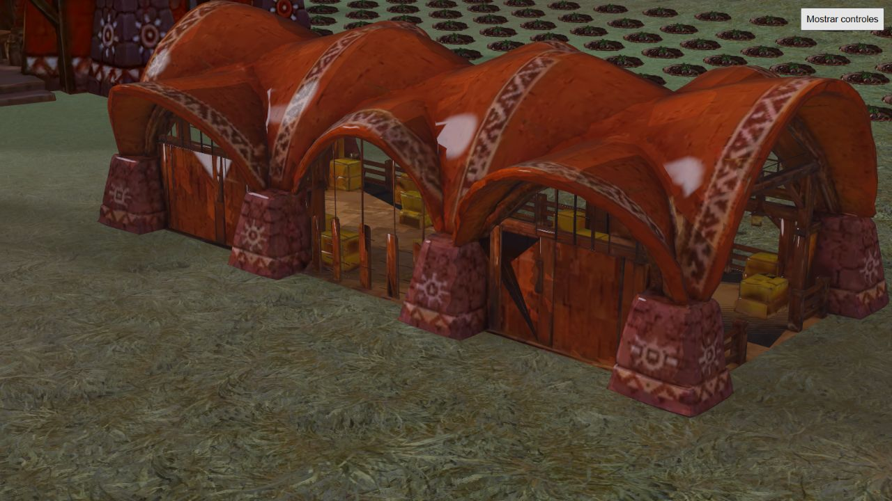
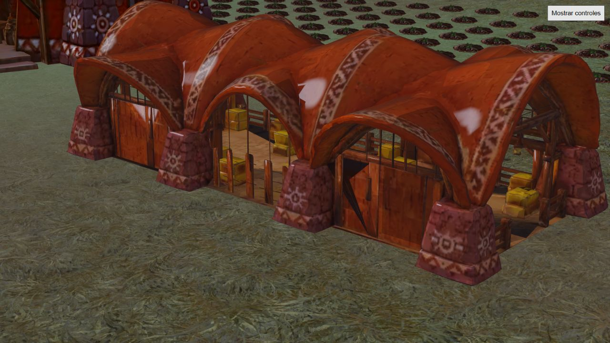

# Contacto del centro de trabajo

Reproducción: `tests/browser/guardian-combat.html?nativeRaid&lightingReview&recoveryDay&buildingView`, botón «Inspeccionar suelo del centro». Usa el centro instalado, su geometría de destrucción, transformaciones reales y la interpolación del terreno renderizado. La inspección pausa la simulación y acerca la cámara.

En la fixture Mapungubwe del vídeo, los 4.697 vértices bajos con normales aproximadamente horizontales quedan por encima del terreno. Separación mínima 0,025 m; ninguna muestra penetra más de 5 mm. El terreno muestreado bajo las peores muestras es plano. No se justifica subir este edificio como arreglo del artefacto comunicado.

Se guardan imágenes de la misma vista con sombras solares y sin ellas. La iluminación interior cambia, pero estas imágenes fijas no certifican ausencia de parpadeo en movimiento. La prueba no examina intersecciones entre caras del propio modelo ni certifica todas las culturas/posiciones. El z-fighting sigue abierto: falta reproducir temporalmente el punto exacto y distinguir sombras de superficies internas superpuestas.

La petición posterior del usuario añade prioridad a precalcular y reutilizar profundidad, sombras y oclusión cuando haya beneficio medido. Ya existe shadow-cache.js con invalidación por entradas geométricas. Antes de duplicar caches hay que medir sus aciertos y costes. Una profundidad de cámara no se puede reutilizar sin invalidar por cámara/oclusores; la luz diurna y los personajes animados tampoco son estáticos. Evaluar por separado AO horneado de modelos, sombras estáticas y componentes dinámicos conservando apariencia. No se ha incorporado aún un nuevo horneado o cache como consecuencia de esta inspección.

## Auditoría del recurso

### Corrección selectiva implementada

building-face-policy.js clasifica una vez la geometría de cada plantilla: las caras sin pareja conservan DoubleSide; una pareja de orientación opuesta muestra solo el frontal de cada miembro, conservando sus UV; copias de la misma orientación se descartan salvo la primera. Se aplica la misma regla a color, profundidad, máscara y sombras mediante el adaptador de shaders de edificios. La regla se desactiva en la capa interior desplazada, cenizas y al comenzar el colapso, donde los fragmentos tienen movimientos independientes. No cambia posiciones, índices, anclaje ni GLB originales.

En Mapungubwe se clasificaron 78 vértices frontales (26 triángulos) y 6 redundantes (2 triángulos); en las otras culturas también se detectaron parejas. No se afirma un ahorro de draw calls o FPS: el objetivo es evitar competencia de profundidad. La clasificación todavía ocurre durante preparación de plantilla, no en cada frame; puede trasladarse a datos horneados si la medición de carga lo justifica.

Validación: 33 pruebas de edificios, destrucción y regla de caras aprobadas; una prueba adicional de clasificación sobre las cinco plantillas reales aprobada. WorldScene carga y renderiza Mapungubwe sin errores de shader. Captura `face-policy.png` revisada sin agujeros evidentes en la vista frontal. Pendiente: comparación temporal al mover cámara, vistas traseras/interiores y destrucción gráfica en las cinco culturas. La corrección de duplicados no certifica todavía la resolución completa del parpadeo comunicado.

### Revisión de daño

### Preparación fuera del hilo principal

La ruta asíncrona calcula ahora la política de caras dentro del worker de geometría y transfiere su Float32Array con el resto de buffers. El constructor gráfico reutiliza ese resultado; la ruta síncrona de compatibilidad conserva el cálculo local. Las cenizas reciben una política neutra sin ejecutar la búsqueda de coincidencias. Ocho pruebas específicas cubren clasificación, transferencia, handler real del worker, cancelación y fallback; build de producción correcto (10,60 s). Esto evita trabajo nuevo en el hilo principal de carga, no es evidencia de mejora de FPS durante una incursión. No se introduce una caché de profundidad de cámara ni se congelan sombras dinámicas.

El visor `tests/browser/buildings.html?faceReview` ahora permite seleccionar cultura y girar 45 grados. Aísla también la máscara separada de apertura, que no hereda la visibilidad del grupo del edificio. Se descartó la primera ronda de capturas: las máscaras de casas ocultas interferían y algunas capturas inmediatas correspondían al fotograma previo. No se publican como validación de cinco culturas.

Con el visor corregido se revisó Mapungubwe al 35 % de daño y en ruina tras avanzar los 3,2 segundos de colapso. Se ven aperturas, capa interior, cenizas y escombros; consola sin errores. Se guardan `mapungubwe-damage35.png` y `mapungubwe-collapse.png`. Es una comprobación del renderizador nativo en visor aislado, no una grabación temporal del juego ni una certificación de sombras solares (el visor no las habilita). Quedan pendientes el movimiento continuo y el resto de culturas con encuadres completos.

`python tools/guardian/audit-building-faces.py docs/guardian/phase2/building-ground-review/face-audit.json` examina los cinco GLB instalados, conserva sus hashes y no los modifica. Encontró grupos de triángulos coincidentes: suajili 44, etíope 35, Mapungubwe 15, saheliana 9 y musgum 24. Mapungubwe además contiene una cara degenerada. La tolerancia de agrupación es 1e-6 por coordenada local; no detecta solapamientos parciales de triangulaciones diferentes.

Inspección adicional de Mapungubwe: el par de caras 6/275 está en y local 0,0259–0,0299, tiene orientación opuesta y UV diferentes. Otros pares coincidentes también usan UV distintos. El renderizador de destrucción crea materiales DoubleSide: ambas superficies pueden competir en profundidad. No se deben borrar todos los duplicados indiscriminadamente porque algunos representan texturas distintas para las dos orientaciones. Investigar culling por cara para estas parejas, preservando las superficies simples de doble cara, y validar la máscara/profundidad de destrucción. Esto identifica una causa plausible concreta, pero aún no demuestra que corresponda al punto exacto visto por el usuario ni constituye una corrección visual validada.

