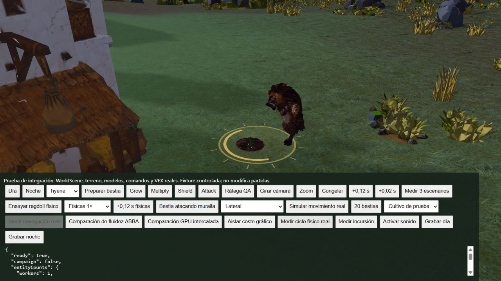

# Diagnóstico continuo de física

La nueva acción **Medir ciclo físico real** en `tests/browser/guardian-combat.html` ejecuta Game.tick y WorldScene continuamente. Prepara una bestia, lanza Attack y registra ocho segundos de simulación, con límite de treinta segundos reales. A diferencia de las mediciones gráficas anteriores que desactivaban el movimiento, incluye el solver y la recuperación reales.

Primera ejecución: hiena, lateral, Intel UHD, 1600 × 900, 233 fotogramas, 8,16 segundos reales y 8,06 simulados. Ningún fotograma con documento oculto. Un ragdoll máximo. Al terminar no queda estado de derribo y la bestia ha retomado el ataque. Audio no desbloqueado.

| Métrica | p95 | p99 | Máximo |
| --- | ---: | ---: | ---: |
| Fotograma completo | 50 ms | 66,4 ms | 83,5 ms |
| Render CPU | 11,5 ms | 13,5 ms | 16,2 ms |
| Actualización física total | 2 ms | 3,1 ms | 16,3 ms |
| Solver | 1,8 ms | 2,4 ms | 5 ms |
| Creación física | 0 ms | 0 ms | 10,6 ms |
| Preparación de recuperación | 0 ms | 0 ms | 4,2 ms |
| Render de recuperación | 1,4 ms | 1,7 ms | 1,8 ms |

Los ceros de percentiles en creación/recuperación reflejan eventos únicos; no significan que esos eventos sean gratuitos. El total incluye etapas que se solapan dentro del mismo fotograma y no se deben sumar máximos de fotogramas distintos. Se registran hasta tres pasos del solver por fotograma. Memoria reportada por Three.js: 190 geometrías y 74 texturas; no equivale a bytes de GPU. Heap JS observado: aproximadamente 453 MB, no una atribución al ragdoll.

Datos completos: [JSON](continuous-hyena-physics.json).

## Interpretación y límites

No es una comparativa antes/después. No demuestra que el precalentamiento redujera el pico ni permite atribuir los 83,5 ms de fotograma a la física. La creación física de 10,6 ms merece una siguiente medición y optimización mediante reutilización. Falta repetición, baseline equivalente, tres ragdolls, incursión masiva, sonido, cámara y análisis de pausas. Rendimiento no aprobado.

El ensayo permite que la IA continúe y cambie de estado; no garantiza identidad de escena entre ejecuciones. No usarlo como benchmark A/B sin restaurar un estado inicial equivalente. También registra si se agota el límite real antes de completar los ocho segundos simulados mediante los dos tiempos del informe.

## Desglose de creación y ajuste de colisionadores

En otra ejecución continua, el arranque de la hiena se desglosó en captura 0,4 ms, ajuste de colisionadores 3,9 ms, entorno 2,1 ms y cuerpos 1,6 ms. Se conserva el estado completo en `creation-stage-baseline.json`. El p99 de fotograma fue 182,6 ms en esa ejecución, muy distinto del ensayo anterior: no se interpreta como efecto de una modificación de física, porque solo se añadió instrumentación y las condiciones no están suficientemente controladas.

Se optimizó el ajuste sin cambiar su resultado: las 96 direcciones de soporte se calculan una vez; los vértices cabeza/cuello se transforman a coordenadas mundiales una vez antes de alimentar ambos soportes; se eliminan los Set temporales por vértice. La comparación profunda de los ajustes antes/después coincide exactamente para las cinco especies. Pasan las catorce pruebas físicas y de integración.

`tools/guardian/measure_collider_fit.mjs` permite medir cuarenta ajustes en caliente por especie y conservar sus resultados completos. El resumen `collider-fit-comparison.json` registra tiempos y hashes de salida de una referencia y dos ejecuciones posteriores. La variación, especialmente un máximo de 52 ms en la primera ejecución posterior, impide afirmar una mejora estable de rendimiento. No se ha creado un pool de cuerpos: la medición señaló primero el ajuste geométrico, y se ha reducido trabajo allí sin cambiar contactos.
