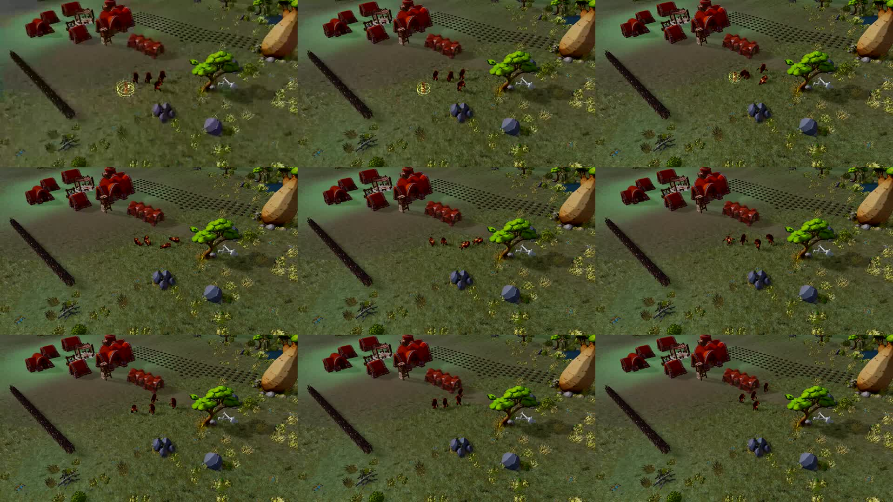

# Native recovery with character LODs — 2026-10-30

This real spatial-WASM WorldScene run exercised four sequential Attack commands against four hyenas, with automatic character LOD, real Game.tick, sound and the production recovery manager. QA restores spell availability; this is not an economy/balance test. URL: `/tests/browser/guardian-combat.html?nativeRaid&lightingReview&characterLod=auto&recoveryOverview&recordPort=5217`, then enable sound and record four impacts.

## Defect found and fixed

The first recording revealed that far hyenas rendered almost black while original models retained fur color. CharacterLod inserted its subtree into the scene before attaching beast-surface metadata. SceneMaterialRegistry immediately prepared the shader during insertion and captured the wrong surface classification. Surface preparation now runs before insertion. The same ordering preserves the older male matte material flag. A regression test observes insertion and requires the metadata to be present already. No geometry, texture, skin or simulation changes were needed.

The initial rejected appearance remains in `lod-cycle-sheet.jpg` and its status JSON; the corrected recording and sampled contact sheet are supplied. Frozen original/low images verify the corrected material response under the same scene lighting. The comparison is visual, not a pixel-identical expectation after geometry reduction.

## Verified scope

The corrected cycle completes all four impacts and all four recoveries, with zero final downed animals and zero runtime errors. Maximum visible Guardian count is one. Peak three physical ragdolls plus one baked fallback. Hurt and impact sounds fire at the falling transition; all four animals subsequently walk. The downloadable full trace is preserved in `recovery-trace.json`; `four-hyena-cycle.webm` contains the actual canvas and audio. Contact sheets sample the recording; their unused black cells are padding, not game frames.

Twelve character-LOD tests pass, including the new material ordering regression. Production build passes (15.15 seconds; existing chunk/import warnings). This bounded run does not close the all-species terrain/obstacle matrix or the voiced DOM tutorial recording.

## Performance limitation

The raw report includes frame, render, animation, solver, recovery and VFX timings. Video capture was active; this is not an interleaved benchmark and must not be compared causally with the preceding rejected run. Large frame spikes remain in these diagnostics. No claim of global fluidity or LOD FPS improvement is made. Unrelated baseline performance remains assigned to the other agent.

