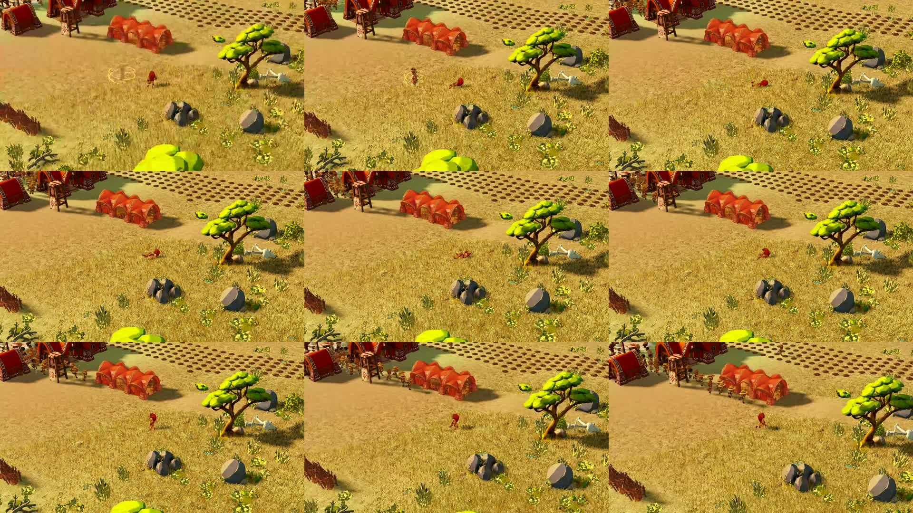
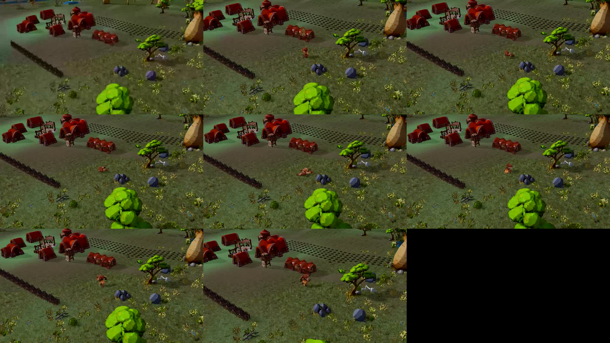

# Native directional impacts — 2026-10-30

Two additional recorded WorldScene/spatial-WASM tests at 7efa3e095, with real Game.tick, production rigs/physics/recovery and audio enabled. No production code or balance was changed in this checkpoint.

| Case | Initial condition | Result |
|---|---|---|
| Lion, side, daylight | Normal health; QA lateral cast origin | falling → rolling → recovering → walking; maximum sampled horizontal displacement while down 1.60 m |
| Rhino, elevated, early night | QA health reduced to one Attack; origin 4 m above contact | falling → rolling → recovering → retreating; maximum sampled horizontal displacement while down 2.32 m |

Both complete 12 simulation seconds, zero runtime errors, no final down state and maximum one visible Guardian. Lion hurt/impact audio occurs at 0.25 s; rhino at 0.283 s. Rhino retreat audio occurs only once retreating, at 8.774 s. Raw traces and canvas recordings with audio are included. No subjective listening approval of the whole sound bank is implied.

These are deliberately different direction/health cases: their displacements do not isolate mass response and must not be compared as a weight benchmark. The rhino exceeds the approximate 1–2 m target by 0.32 m in this case; retain this observation for matched-condition tuning rather than hiding it or changing balance from two unmatched samples. Displacement is relative to the first sampled actor position, including physical settling and rolling; it is not projectile flight distance.

Reproduction: `/tests/browser/guardian-combat.html?nativeRaid&lightingReview&characterLod=auto&recoveryClose&recordPort=5217`. Add `recoveryDay` for lion or `retreatTrial` for the reduced-health rhino. Select species and Lateral/Elevado, activate sound, then Grabar ciclo seleccionado. A local receiver on the selected port saves combat-cycle.webm. The QA direction selector overrides the automatic cast origin; these clips therefore do not validate automatic placement near buildings. The camera follows recovery as part of the QA framing, not a gameplay camera change.

The lion recording lasts about 43 seconds for 12 simulation seconds, so it is not evidence of acceptable fluency. Raw timing remains available, but global performance investigation stays with the other agent. Contact sheets sample every 5 seconds (lion) and 2 seconds (rhino), with black padding where no frame exists. Sampling supports visible fall/get-up inspection, not frame-by-frame collision certification.

