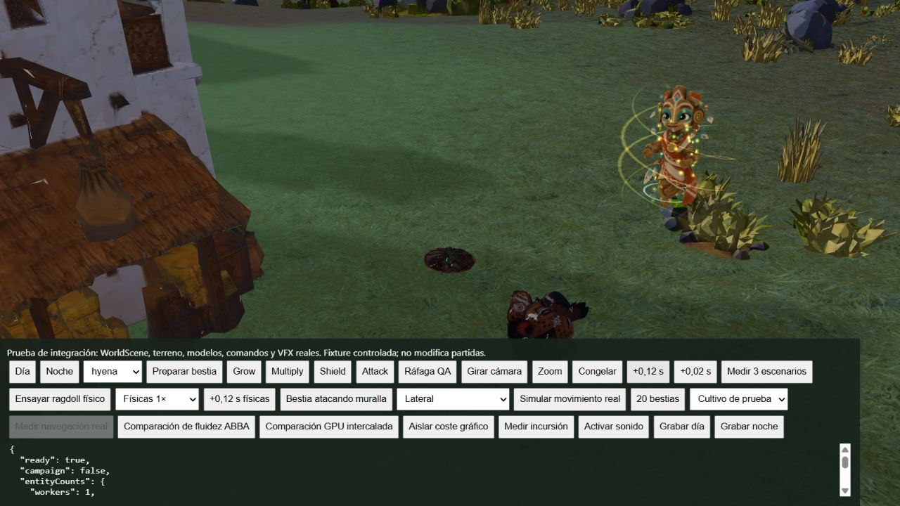
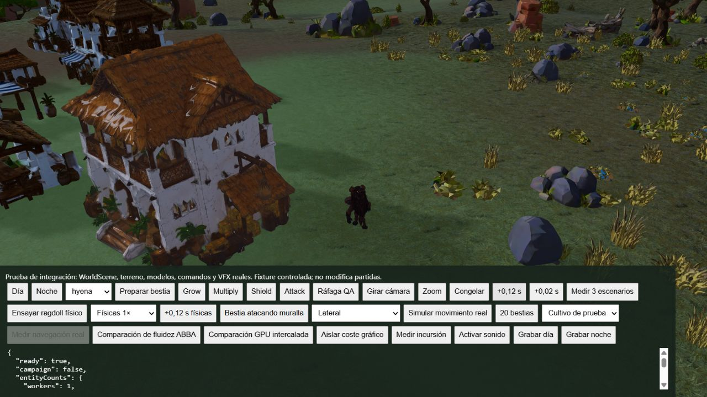

# Recorrido físico: referencia antes de ajustar el impulso

Comando: `node tools/guardian/measure_actual_ragdoll.mjs docs/guardian/phase2/ragdoll-center-travel-baseline.json`.

Se usan los cinco GLB actuales, sus pesos y colisionadores ajustados a la piel, en pose de reposo, sobre suelo plano y durante 360 pasos a 60 Hz. El centro se calcula con la masa y el centro de masa mundial de cada cuerpo rígido. Se separa del recorrido de la pelvis, que cambia también al girar o caer. Las mediciones de CPU son exclusivamente Node, no rendimiento del juego.

| Especie | Horizontal: centro de masa | Lateral: centro de masa | Observación |
| --- | ---: | ---: | --- |
| Hiena | 1,97 m | 1,47 m | Lateral no alcanza reposo en 6 s |
| Jabalí | 1,14 m | 0,75 m | El recorrido depende de la orientación |
| León | 0,67 m | 1,87 m | Descendente no alcanza reposo en 6 s |
| Búfalo | 1,88 m | 1,16 m | La masa por sí sola no predice el recorrido final |
| Rinoceronte | 1,04 m | 0,65 m | Lateral se estabiliza a los 5,58 s |

No se ha cambiado el impulso. Aumentar globalmente su velocidad no está justificado por estos resultados: algunos casos ya rozan 2 m y otros presentan falta de reposo. La comparación previa del desplazamiento de pelvis no bastaba para validar la resistencia por especie.

El controlador real fuerza la transición a recuperación al superar cinco segundos aunque el solver no indique reposo. Es un mecanismo de salida, no evidencia de estabilización física. Se debe inspeccionar en pantalla la transición en estos tres casos antes de aprobarla.

Siguientes comprobaciones necesarias: captura de poses de caminar/atacar del juego, escala y orientación reales, plano y pendiente, impacto lateral/descendente, contacto de piel y articulaciones, continuidad al levantarse. El ensayo actual no sustituye esas comprobaciones ni prueba los 1–2 m durante una incursión.

## Experimento de estabilización

La telemetría del último segundo identifica el mayor movimiento residual en el pie derecho de la hiena lateral (hasta 6,92 rad/s) y el antebrazo derecho del león descendente (hasta 1,12 m/s). Esto localiza la inestabilidad, pero no demuestra por sí solo si procede del colisionador, la restricción o su interacción.

Se compararon 12, 16 y 24 iteraciones. Con 16 la hiena lateral sigue sin estabilizarse. Con 24 los quince casos alcanzan reposo durante el ensayo, pero la suite ampliada falla: rinoceronte con penetración de piel de 0,0703 m y salto inicial de recuperación de 0,0528 m. Por tanto, se rechaza el cambio global. No se han relajado los umbrales para aprobarlo.

La producción conserva 12 iteraciones y sus siete pruebas físicas pasan de nuevo. El solver acepta ahora un parámetro explícito para experimentos; el medidor recibe el número como tercer argumento. Los informes `ragdoll-solver-12.json`, `ragdoll-solver-16.json` y `ragdoll-solver-24.json` conservan las mediciones. Los tiempos de una sola ejecución no permiten atribuir una regresión de rendimiento con fiabilidad.

Pendiente: reproducir gráficamente las direcciones problemáticas con poses animadas, revisar los soportes del pie/antebrazo y validar una corrección que también conserve contactos de piel y continuidad de recuperación. Ninguna de las variantes se declara aprobada visualmente.

## Corrección aplicada: amortiguación relativa y soporte cabeza/cuello

Se añade un motor de velocidad objetivo cero con factor 2,5 a las articulaciones: amortigua el movimiento relativo sin imponer una pose ni aumentar el impulso. Se conservan doce iteraciones. Los vértices de la unión cabeza/cuello con al menos un 25% de peso en el segundo hueso se incluyen en ambos colisionadores; antes solo se incluían en el de mayor peso. Esto cubre piel compartida que podía quedar fuera del soporte al doblar el cuello.

La inclusión compartida en todas las articulaciones se descartó porque alteraba otras caídas. También se descartaron factores de amortiguación 2 y 3: el primero no sostenía el reposo del león lateral y el segundo dejaba una hiena sin reposo en la prueba de contacto a ocho segundos. No se modificaron tolerancias para aceptar esos resultados.

Nueve pruebas pasan, incluida una regresión de quince combinaciones de especie y dirección que exige reposo sostenido durante 0,3 s dentro de seis segundos. La suite de piel y recuperación conserva sus límites originales. Informe numérico actual: `ragdoll-joint-damping.json`. Esto sigue siendo una muestra finita de poses, no garantía sobre todas las caídas.

Prueba gráfica de WorldScene con comandos y simulación reales, reloj avanzado por pasos de 0,12 s, hiena, impacto lateral, Intel UHD 1600 × 900: caída articulada visible; recuperación ya activa a 3,48 s desde contacto, antes del límite forzado de 5 s; regreso a locomoción y cero simulaciones activas a 5,28 s. Posición inicial (90, -6), posición al recuperar (89,793, -3,876): desplazamiento lógico aproximado de 2,13 m. Errores reportados: ninguno. Máximo de Guardianes: uno.

Límites: la interfaz tapa parte de la primera caída y el zoom posterior limita la inspección anatómica fina; no es un vídeo ni aprobación de naturalidad a velocidad real. Audio desactivado. Falta comprobar león descendente y otras especies/obstáculos gráficamente. El pico observado de actualización física fue 21,2 ms y el arranque 10,8 ms; son observaciones de pasos manuales, no percentiles de una incursión ni una comparación antes/después. Rendimiento todavía no aprobado.
