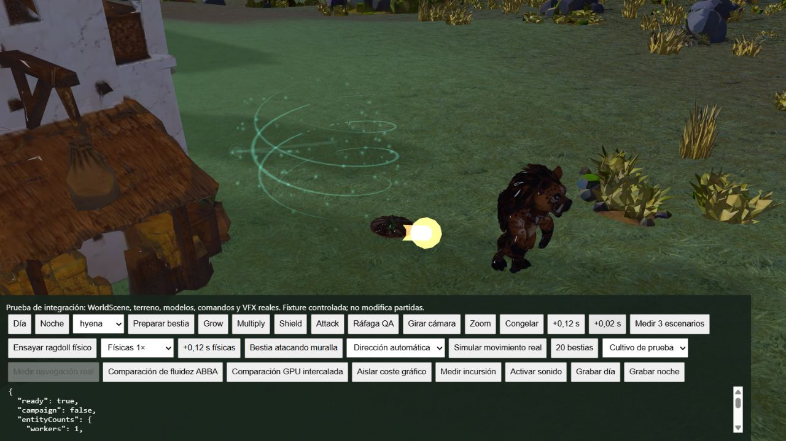
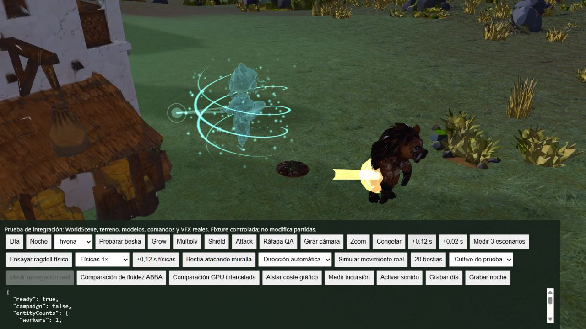

# Attack interrumpido por otra invocación

El cuerpo del Guardián sigue siendo único. Si una nueva magia sustituye su aparición antes de terminar un Attack, la descarga anterior conserva su origen, contacto y reloj en un pool de ocho registros. Sus geometrías se comparten con el sistema existente; la energía residual requiere como máximo tres draw calls instanciados en conjunto. Al saturarse el pool se descarta el efecto más antiguo, sin modificar el resultado de juego.

La descarga se cancela si desaparece el objetivo antes del contacto. Un destello de impacto ya iniciado puede terminar su desvanecimiento. Final de partida, cambio de estado, retroceso del reloj y dispose limpian la presentación. La geometría prestada se libera únicamente por su propietario.

## Evidencia ejecutada

- Seis pruebas Node: reutilización de un solo cuerpo, carga/vuelo/contacto, continuidad al sustituir Attack, límite de ocho registros, desaparición del objetivo y liberación de recursos.
- Escena `tests/browser/guardian-combat.html`, WorldScene y comandos reales, Intel UHD Graphics, 1600 × 900, calidad media.
- Noche; reloj congelado; Attack; avance de 0,12 s; Shield; avance de 0,04 s. A edad 0,16 s del Attack permanece una descarga residual con dos draws y un único Guardián.
- A edad 0,28 s se observa el contacto en la hiena y tres draws residuales, mientras el Guardián se materializa para Shield en su nueva posición.
- A edad 0,64 s no quedan registros ni draws residuales. Máximo observado: un Guardián. Errores reportados: ninguno.

## Límites de esta prueba

Se avanzó el reloj manualmente con la simulación de navegación desactivada. No valida ragdoll, movimiento de la bestia ni sincronización audible: el audio no estaba desbloqueado. No es una medición de frametime ni demuestra el coste durante una incursión masiva. La forma del proyectil sigue siendo geométrica y requiere más trabajo artístico para el acabado cinematográfico solicitado. La saturación del pool está probada por código, no gráficamente con ocho descargas simultáneas.
