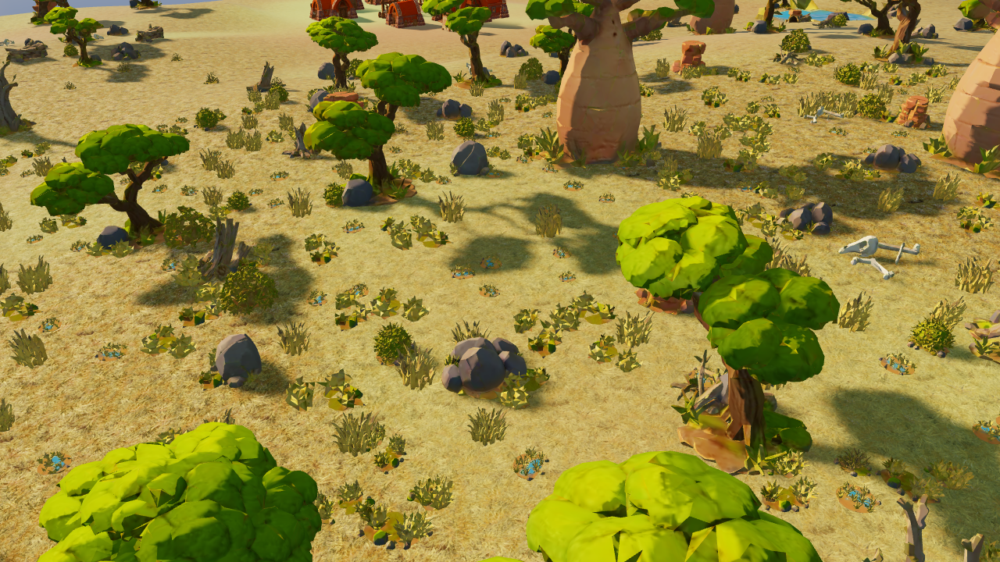
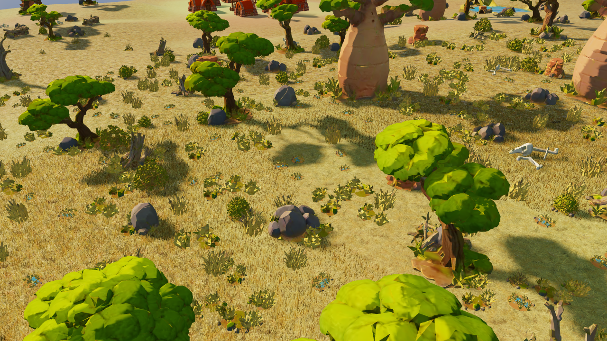
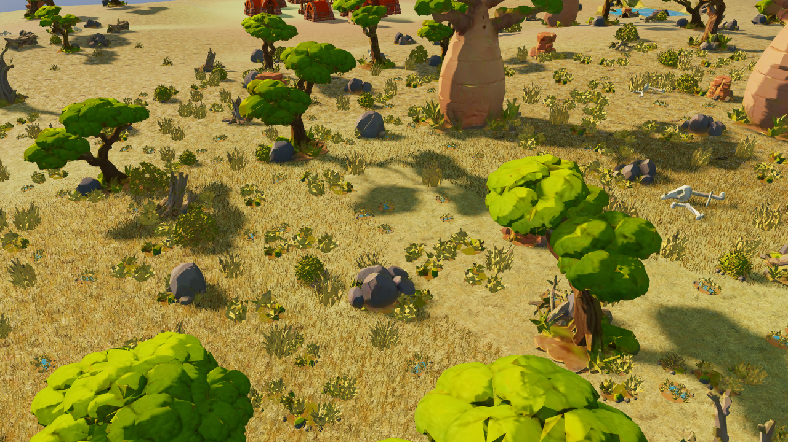
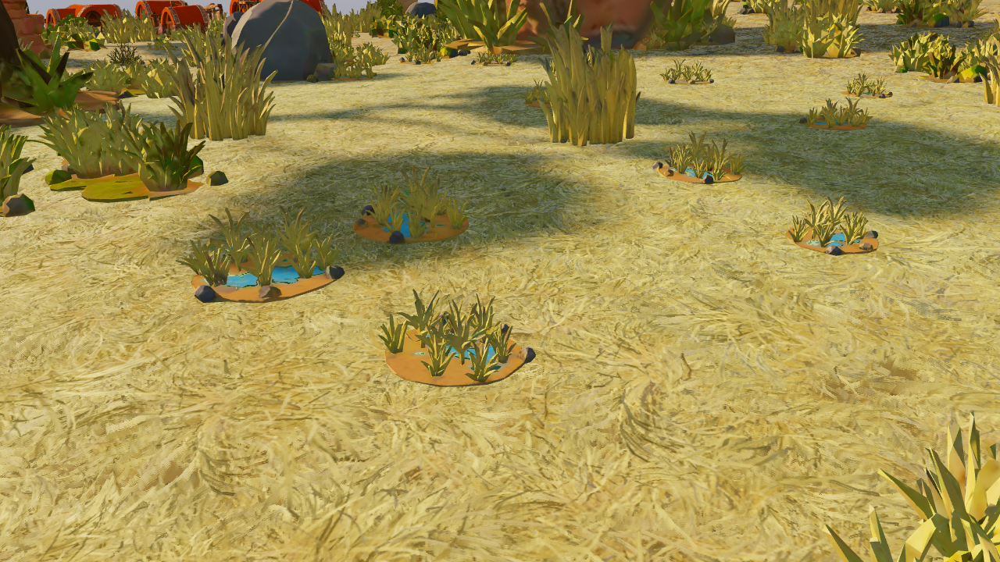
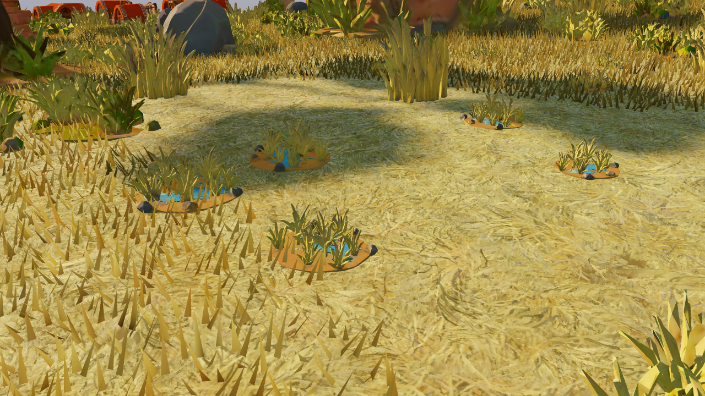
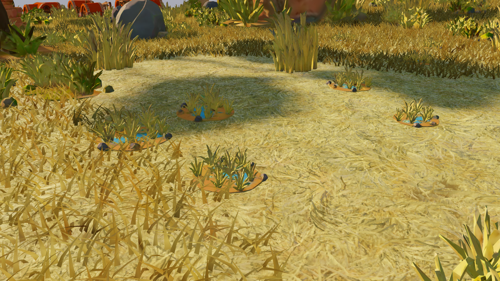

# Cubierta herbácea continua: piloto de Sabana

20/10/2026 · `codex/global-visual-lab` · semilla 712 · renderer real WebGL2 · Intel UHD 0x9A60 / ANGLE D3D11 · 1280×720.

**Conclusión: la adaptación conceptual es viable como prototipo.** La geometría ya forma franjas de cobertura continua desde la cámara normal, en vez de unas pocas matas añadidas. C ofrece fibras arqueadas y viento; el perfil bajo conserva el viento con geometría ligera. **No se ha alcanzado la finura ni la agrupación orgánica de la referencia RheaGrass, y no se propone activar esto por defecto ni extenderlo todavía a otros biomas.**

El [objetivo vigente](OBJECTIVE.md) sustituye los retoques de matas aisladas y POM. Las matas, edificios y demás modelos originales permanecen intactos. Esta entrega añade herramientas QA y geometría visual independiente; no modifica código de simulación, navegación, terreno autoritativo ni la selección predeterminada del juego.

## Actualización: viento extraordinariamente más fuerte

La variante C utiliza ahora una amplitud de viento **8×**. Las capturas y métricas de este informe conservan la intensidad original (1×); la nueva [comparación de vídeo y rendimiento](../continuous-grass-wind-strong/README.md) documenta el cambio de forma independiente.

## Comparativa real

Cámara normal, día, calidad media (clic para resolución completa):

| A: original | B: ligera | C: refinada |
|---|---|---|
| [](media-game-day-A.webp) | [](media-game-day-B.webp) | [](media-game-day-C.webp) |

Cámara cercana, mismo punto y hora:

| A | B | C |
|---|---|---|
| [](media-close-day-A.webp) | [](media-close-day-B.webp) | [](media-close-day-C.webp) |

| Calidad | Vista | Día A / B / C | Noche A / B / C |
|---|---|---|---|
| media | close | [A](media-close-day-A.webp) / [B](media-close-day-B.webp) / [C](media-close-day-C.webp) | [A](media-close-night-A.webp) / [B](media-close-night-B.webp) / [C](media-close-night-C.webp) |
| media | game | [A](media-game-day-A.webp) / [B](media-game-day-B.webp) / [C](media-game-day-C.webp) | [A](media-game-night-A.webp) / [B](media-game-night-B.webp) / [C](media-game-night-C.webp) |
| media | elevated | [A](media-elevated-day-A.webp) / [B](media-elevated-day-B.webp) / [C](media-elevated-day-C.webp) | [A](media-elevated-night-A.webp) / [B](media-elevated-night-B.webp) / [C](media-elevated-night-C.webp) |
| baja | close | [A](baja-close-day-A.webp) / [B](baja-close-day-B.webp) / [C](baja-close-day-C.webp) | [A](baja-close-night-A.webp) / [B](baja-close-night-B.webp) / [C](baja-close-night-C.webp) |
| baja | game | [A](baja-game-day-A.webp) / [B](baja-game-day-B.webp) / [C](baja-game-day-C.webp) | [A](baja-game-night-A.webp) / [B](baja-game-night-B.webp) / [C](baja-game-night-C.webp) |
| baja | elevated | [A](baja-elevated-day-A.webp) / [B](baja-elevated-day-B.webp) / [C](baja-elevated-day-C.webp) | [A](baja-elevated-night-A.webp) / [B](baja-elevated-night-B.webp) / [C](baja-elevated-night-C.webp) |

[Vídeo de viento, cámara fija, 5 s](wind-fixed-camera.mp4) · [Movimiento de cámara y LOD, 4 s](camera-lod.mp4). Los clips contienen frames reales a tiempos de shader deterministas, codificados a 30 fps; **no son una medición de FPS en tiempo real**. Los benchmarks se toman del bucle real por separado. En el clip móvil puede aparecer el dithering de oclusión de árboles que ya aplica el juego.

48 capturas: 36 de A/B/C y 12 controles A2. Los 12 retornos a A son idénticos byte a byte al PNG inicial ([hashes](original-return.json)). Los WebP publicados son sin pérdida y se verifican contra los píxeles PNG. [Manifiesto media](captures-media.json), [manifiesto baja](captures-baja.json): cámara, objetivo, hora, contadores y errores. `rawCaptureFile` identifica el PNG reproducible local; `file` es el WebP publicado.

## Unidad de cobertura y presupuesto

| Variante | Representación | Densidad nominal antes de máscaras |
|---|---|---|
| A | Suelo y vegetación originales, nueva cobertura oculta | 0 |
| B media | Módulo de 0,4 × 0,4 m, 8 hojas triangulares opacas | 50 hojas / triángulos por m² |
| C media, cerca | 12 hojas arqueadas, 5 triángulos por hoja | 75 hojas, 375 triángulos por m² |
| B baja | Paso de 0,5 m, módulo ligero | 32 hojas / triángulos por m² |
| C baja, híbrida | Misma geometría ligera que B, con viento | 32 hojas / triángulos por m² |

C media converge a B entre 18–24 m de distancia horizontal. La altura/ancho se reducen hasta desaparecer en los últimos 12 m del radio visible: 48 m en media, 40 m en baja. La textura existente sigue resolviendo la distancia y el suelo descubierto. El LOD horizontal conserva más geometría bajo una cámara elevada; su coste se mide, no se oculta.

La versión inicial de C tenía 36 triángulos/módulo y parecía demasiado afilada. La retenida cambia la forma y el solapamiento, **sin aumentar la población**. B mantiene alturas base de 0,26–0,42 m; C arqueada usa el 85 % de esa altura y mayor inclinación. Anchuras de 0,045–0,070 m, con escala local de cobertura. La generación Blender usa semilla 712; [malla fuente](modules.blend), [auditoría](mesh-audit.json) y `tools/experiments/blender-continuous-grass.py` permiten reconstruirla.

En la vista normal de media, C muestra 2.438 módulos cercanos y 8.303 ligeros: **95.680 hojas, 212.704 triángulos adicionales y dos draw calls**. En baja híbrida: **4.620 módulos, 36.960 hojas/triángulos y un draw call**. Se reservan como límites 12.000 módulos cercanos y 18.000 ligeros; no se alcanza el límite en las pruebas. No hay un Object3D por hoja ni alpha blending/cutout. Las cards no se han medido: este piloto demuestra una alternativa opaca, no que las cards sean inferiores.

## Integración visual y técnica

- Dos geometrías compartidas con atributos instanciados. Selección por sectores de 8 m dentro de los chunks residentes de 48 m, frustum y distancia. Los sectores se ordenan aproximadamente de cerca a lejos; no se ordenan miles de instancias cada frame.
- Altura y pendiente se interpolan desde la malla residente 49×49; cobertura, humedad, variación y desgaste se leen del mapa residente. Se copian las huellas de ocupación ya disponibles y se usa distancia poligonal JavaScript. No se invocan consultas de navegación ni métodos de Wild Engine. La humedad influye en la variación cromática; la cobertura controla presencia y altura.
- Exclusión de caminos/desgaste, pendientes fuertes, cultivos, agua y edificios. Margen de 0,6 m para el alcance de las hojas; los bounds de agua son conservadores. Los eventos existentes invalidan la caché visual. Los claros del centro de las capturas son regiones excluidas por las máscaras, no huecos aleatorios entre matas.
- El color se toma del mismo mapa de suelo Grass Medium 01. No se modifica el material de fondo, sus normales ni su POM. La geometría domina las franjas cubiertas, pero el suelo continúa visible entre fibras, especialmente desde arriba y en calidad baja.
- Viento analítico compartido en coordenadas de mundo, con dos ondas espaciales y flexión creciente hacia la punta. Raíces ancladas; normales ajustadas aproximadamente. El CPU solo actualiza tiempo y selección visual.
- Iluminación continua sencilla con paleta día/noche y exposición existentes. Gradiente de raíz a punta; no se añade un bake AO ni texturas nuevas. Una consulta lógica de albedo por vértice y una comparación de sombra por fragmento (el filtrado hardware puede implicar varios texels). No hay sombras individuales de hojas ni nuevas pasadas en la ruta normal.

## Rendimiento medido

Mediana GPU del **frame completo**, en ms. Calidad media y baja son ejecuciones independientes; no comparar sus valores como si solo cambiara la hierba.

| Calidad | Vista / hora | A | B | C |
|---|---|---:|---:|---:|
| media | close / day | 19.93 | 21.33 | 22.48 |
| media | close / night | 20.44 | 21.12 | 20.14 |
| media | game / day | 19.89 | 20.38 | 21.14 |
| media | game / night | 22.48 | 22.09 | 22.63 |
| media | elevated / day | 16.70 | 17.30 | 19.00 |
| media | elevated / night | 17.48 | 17.74 | 18.28 |
| baja | close / day | 14.53 | 16.26 | 15.70 |
| baja | close / night | 15.93 | 16.09 | 16.25 |
| baja | game / day | 16.69 | 16.90 | 16.76 |
| baja | game / night | 16.38 | 16.26 | 16.27 |
| baja | elevated / day | 10.57 | 11.15 | 11.09 |
| baja | elevated / night | 11.48 | 12.31 | 12.62 |

[Tabla completa CPU/GPU, p95, draws y triángulos](BENCHMARKS.md) · [datos media](benchmarks-media.json) · [datos baja](benchmarks-baja.json). 72 bloques A/B/C/C/B/A, 30 frames de calentamiento y 120 muestras por bloque: **8.640 muestras GPU válidas**, sin disjoint, pérdidas de contexto ni errores registrados. Hay deriva entre bloques; diferencias pequeñas o negativas son ruido, no aceleración atribuible a la hierba. En media normal diurna, C pasa de 19,89 a 21,14 ms (+1,26); en cercana diurna, de 19,93 a 22,48 (+2,55). No se garantizan 60 fps: el original ya supera 16,67 ms en varias escenas.

El C pesado inicialmente probado en baja alcanzó 17,10 ms en cercana nocturna frente a 14,71 de A. Se conserva su [benchmark descartado](pilot-low-refined/benchmarks-baja.json). La alternativa híbrida elimina 81.120 triángulos en la vista normal y conserva el viento. Su ejecución final cercana nocturna mide A 15,93 / C 16,25 ms; las bases temporales difieren, por lo que no debe restarse directamente 17,10−16,25 como una ganancia aislada.

**Movimiento y streaming.** En 120 posiciones de cámara, selección media: mediana 0,60 ms, p95 1,30 y máximo 4,30. En baja: mediana 0,30, p95 0,90 y máximo 3,90. La primera generación/selección de la zona cuesta aproximadamente 38 ms en media y 22 ms en baja: hay un pico de activación que debe amortizarse antes de una integración. Los sectores nuevos durante el recorrido añaden hasta 1 ms de generación en media. El desplazamiento de 288 m y retorno tarda aproximadamente 0,9–1,1 s en cargar el mundo completo; no es tiempo atribuible solo a la cobertura. Distribución idéntica al regresar en ambas calidades, sin desbordar presupuestos. Invalidar y reconstruir conserva la distribución con el mismo estado. [Media](streaming-media.json), [baja](streaming-baja.json).

**Memoria.** Medida CDP tras GC, en cámara normal: +2,06 MB de heap JavaScript en media y +1,11 MB en baja, incluyendo importación QA/cachés. Los arrays de geometría/instancing reservan 1.206.456 bytes; en baja solo se dibuja/sube la geometría ligera. Son magnitudes distintas, no una medida de VRAM total. WebGL2 no expone la memoria real del controlador. Se añaden dos geometrías en media y una en baja; cero texturas. Al liberar el experimento vuelven los contadores originales de geometrías/texturas/programas. [Media](memory-media.json), [baja](memory-baja.json).

**Overdraw.** Diagnóstico independiente: profundidad del mundo original y acumulación de fragmentos de hojas, desactivando la escritura de profundidad entre ellas. Estima solapamiento potencial visible; la ruta opaca real puede rechazar más fragmentos por early-Z. C media: 1,75 fragmentos/píxel de hierba en cercana, 1,22 en normal y 1,18 elevada. C baja: alrededor de 1,38 / 1,10 / 1,06. Dos píxeles cercanos de media saturan el contador de 16, así que allí es un límite inferior. En normal media la hierba ocupa un 11 % de toda la imagen, incluidos objetos y claros; **no es el porcentaje de cobertura de la región herbácea**. Estas pasadas solo existen en el diagnóstico, no en el juego. [Media](overdraw-media.json), [baja](overdraw-baja.json).

## Iteraciones y límites

| Ensayo | Evidencia y decisión |
|---|---|
| Sombra comparada en vertex shader | ANGLE/Intel produjo X4532 y pérdida de contexto. Se trasladó la consulta al fragment shader; no se retienen capturas negras como evidencia. |
| Altura casi cero en bordes | [Parecía una capa de escamas](pilot-v1/media-close-day-C.webp). Descartado. |
| C con tres triángulos por hoja | [Demasiado rígida/afilada](pilot-v2/media-close-day-C.webp). Se retienen cinco triángulos y mayor curvatura, sin más módulos. |
| Ordenar cada instancia al mover cámara | Selección mediana de 3,9 ms. Sustituido por orden de sectores y copia directa a buffers; mediana final 0,6 ms en media. |
| C pesado en baja | [Más detalle del necesario](pilot-low-refined/baja-game-day-C.webp) y coste nocturno desfavorable. Sustituido por geometría ligera con viento. |

La lectura de cobertura continua está demostrada en las franjas permitidas por las máscaras. La calidad artística todavía tiene límites: hojas anchas y facetadas en primer plano, repetición perceptible al inspeccionar, suelo aún visible desde arriba y transición a textura reconocible al alejarse. El movimiento de cámara no muestra pérdidas de chunks en los frames inspeccionados; el clip se entrega para revisar temporalmente LOD y aliasing fino. No se certifica ausencia de todo popping a cualquier trayectoria.

La prueba de invalidación no equivale a una campaña prolongada con construcción, destrucción y cultivos simultáneos. Tampoco se han medido otros dispositivos, resoluciones, biomas o una sesión larga con carga máxima. Las sombras de hojas, interacción con personajes y cards no forman parte de esta implementación.

**Recomendación:** conservar C media y C baja híbrida como candidatos QA de cobertura, con B como control de coste. Continuar sobre la forma colectiva, agrupación y transición LOD; no volver a matas decorativas aisladas ni aumentar indiscriminadamente densidad. Antes de promoverlo al renderer experimental global, amortizar la activación y revisar las capturas/vídeos frente a RheaGrass. Mantener la PR en borrador y no fusionar.

## Fuentes y reproducción

[RheaGrass](https://github.com/Ryan-Gee/RheaGrass), revisión inspeccionada `bdf2dd4cbed87e496cc289c1bb20ee6245259a18`, CC0-1.0: referencia conceptual/artística. No se copia su código, geometría ni atlas. No se trasladan geometry/tessellation shaders. Las mallas se generan aquí con Blender. [Grass Medium 01 de Poly Haven](https://polyhaven.com/a/grass_medium_01), CC0, ya formaba parte del juego y sigue siendo el material subyacente.

Servidor Vite del worktree en `http://127.0.0.1:5190`. Los harnesses inyectan únicamente una referencia QA al mundo en la respuesta de desarrollo; no modifican `src/rendering/scene.js`.

```powershell
$env:WG_COVER_QUALITY='media,baja'
node tools/experiments/capture-continuous-grass.mjs
node tools/experiments/measure-continuous-grass.mjs
node tools/experiments/overdraw-continuous-grass.mjs
node tools/experiments/memory-continuous-grass.mjs
node tools/experiments/streaming-continuous-grass.mjs
$env:WG_COVER_QUALITY='media'
node tools/experiments/video-continuous-grass.mjs
python tools/experiments/summarize-continuous-grass.py
python tools/experiments/package-continuous-grass.py
```

Ejecutar mediciones sin otros trabajos GPU/compresión. `video-continuous-grass.mjs` produce secuencias PNG; los MP4 se codifican con FFmpeg, `-framerate 30 -c:v libx264 -crf 18 -pix_fmt yuv420p`. Para ver viento en una sesión QA no pausada, usar `world.qaContinuousGrass.timeOverride=null`; capturas/benchmarks mantienen fase determinista. Este módulo está preparado para QA en desarrollo, no es una opción publicada del menú.

Validación de entrega: `npm run build` pasa (406 módulos; avisos existentes de tamaño/importación mixta), sintaxis JS/Python comprobada, manifiestos/enlaces locales y errores GL revisados. El campo `engineQueries:0` de las auditorías describe la arquitectura revisada en código; no es un contador instrumentado del motor.

## Ensayos posteriores descartados

- [Orientación coherente](../continuous-grass-flow/README.md): acentúa franjas y repetición.
- [Láminas curvas recortadas](../continuous-grass-cards/README.md): reducen triángulos, pero pierden cuerpo en la cámara normal.

Ambos cuentan con 18 capturas reales y controles de restauración idénticos. No sustituyen C ni su viento 8×; su descarte es visual, sin conclusión de rendimiento.

- [Agrupaciones de altura](../continuous-grass-cluster/README.md): dos escalas probadas; la más visible amplifica demasiado el estiramiento bajo viento 8×. Se conserva C.

## Alternativa de viento por rotación

[Vídeos, auditoría y benchmarks](../continuous-grass-rotation/README.md): limita el estiramiento radial manteniendo movimiento fuerte, pero no conserva todas las aristas y añade coste en calidad media diurna. Se conserva como QA independiente; C 8× sigue siendo la versión principal.

## Revisión interactiva

El [panel QA](../continuous-grass-review/README.md) permite comparar A/B/C y controlar fuerza y congelación del viento, cámara e iluminación en el juego real. Abre C con viento 8× en un navegador aislado; no modifica el arranque normal.
