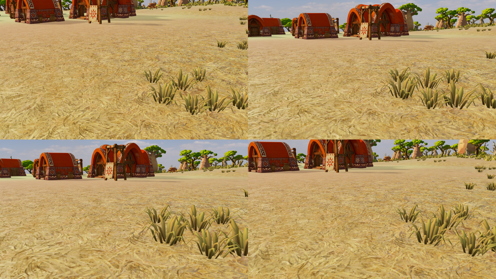

# Viento en matas 3D: primer prototipo WebGL2

2026-10-20. QA únicamente, Sabana; sin cambios en producción, simulación o navegación. Implementación propia inspirada en la investigación RheaGrass, sin copiar código ni recursos del proyecto Unity.

## Resultado visual y recomendación

Se consigue flexión de las matas existentes mediante vertex shader, con raíces ancladas y normales ajustadas mediante la inversa transpuesta de la deformación. Dos ondas espaciales producen variación entre matas. No se añaden texturas de viento. Las mallas siguen siendo las matas curvas de Blender existentes (`grass-arched.glb`), no planos cruzados.

El movimiento es discreto y mantiene la lectura de las matas en las muestras inspeccionadas. No genera la capa de fibras acumuladas del mockup ni cambia el suelo. Conservar como candidato QA, no activar por defecto: faltan sombras proyectadas animadas, recorrido largo, origen flotante y validación de pausa/reanudación. No extender todavía a los seis biomas.

- [Vídeo diurno estático](motion-day-static.webm) / [con viento](motion-day-wind.webm).
- [Vídeo nocturno estático](motion-night-static.webm) / [con viento](motion-night-wind.webm).
- [Antes](media-close-day-static.webp) / [viento a 2 segundos](media-close-day-wind2.webp).

Los vídeos son 72 frames deterministas a 20 fps de reproducción; no son una medición de FPS. Se inspeccionaron muestras temporales, no se certifica ausencia de todos los artefactos temporales. La cámara sigue el mismo recorrido en controles y variante. Las capturas fijas incluyen cerca/juego y día/noche, semilla 712, 1280×720, calidad media.

## Coste medido

Intel UHD / ANGLE, campaña real. 30 frames de calentamiento y 120 muestras GPU por bloque; orden estático/viento/viento/estático. CPU es envío de render, no simulación completa. La versión estática omite el código de viento del shader; ambas usan exactamente la misma geometría y colocación. El benchmark anima el tiempo de viento durante la medición.

| Perfil | Vista | Hora | GPU estático / viento (ms) | Delta | CPU estático / viento (ms) |
|---|---|---|---:|---:|---:|
| media | close | day | 15.105 / 15.231 | +0.84% | 3.675 / 3.552 |
| media | close | night | 16.569 / 15.627 | -5.68% | 4.014 / 3.649 |
| media | game | day | 15.572 / 15.311 | -1.68% | 3.549 / 3.585 |
| media | game | night | 16.652 / 16.045 | -3.65% | 3.383 / 3.190 |
| baja | close | day | 11.073 / 11.990 | +8.28% | 3.924 / 3.922 |
| baja | close | night | 11.979 / 12.246 | +2.23% | 3.480 / 3.513 |
| baja | game | day | 11.962 / 11.009 | -7.97% | 3.728 / 3.743 |
| baja | game | night | 11.660 / 11.404 | -2.20% | 3.564 / 3.690 |

Repetición del caso baja/cerca/día: cuatro bloques por variante, 480 muestras cada una. Estático 10.916 ms GPU, viento 10.794 ms; CPU 3.579 / 3.652 ms. El +8.28% inicial no se reproduce. Hay deriva considerable entre bloques (primer estático 12.298 ms, siguientes 10.654/10.261/10.450), por lo que los deltas negativos NO demuestran una aceleración y tampoco queda probado un límite estricto del 5%. No se detecta un sobrecoste grande y consistente; falta una medición más estable para aceptar producción.

Total 4 800 muestras GPU entre matriz y repetición. Sin errores de consola/página registrados. Medias, p95 y muestras crudas se conservan en JSON.

Ambas variantes: 192 matas de 240 triángulos = 46 080 triángulos. En media, escena completa cercana 81 draws / 1 142 303 triángulos; normal 71 / 965 516. Respecto al juego sin esta capa QA son +1 draw y +46 080 triángulos. El viento añade cero geometría, instancias o draws sobre el control estático. Texturas en ambas: 61 en las mediciones de media; no se asignan mapas nuevos para viento. No se midieron bytes internos de programas GPU; no confundir contadores de recursos con memoria exacta del driver.

## Límites técnicos

- La animación se controla mediante uniforms QA; los scripts avanzan el tiempo. No está conectada al reloj de producción.
- Las matas reciben sombras, pero `castShadow=false`. Habilitar proyección exige deformación idéntica en el material de profundidad y medición adicional.
- La distribución reutiliza el streaming experimental, presupuesto e histéresis existentes. El culling no se ha certificado para recorridos largos con esta deformación.
- No hay simulación física ni interacción con personajes. Los edificios, suelo y actores no reciben la deformación.
- La captura estática inicial utilizaba intensidad cero; el benchmark y los vídeos usan un programa estático sin matemáticas de viento.

## Reproducción

Servidor de este worktree en 5190. `node tools/experiments/capture-grass-wind.mjs`, `node tools/experiments/measure-grass-wind.mjs`, `node tools/experiments/record-grass-wind.mjs`; resumen con `python tools/experiments/summarize-grass-wind.py`. Los capturadores escriben PNG; los publicados se archivaron como WebP sin pérdida. Playwright Chrome y ffmpeg son necesarios para los vídeos. La repetición usa WG_POM_QUALITY=baja, WG_WIND_VIEWS=close, WG_WIND_PHASES=day, WG_WIND_ORDER=static,wind,wind,static,wind,static,static,wind y WG_WIND_SUFFIX=-repeat.
