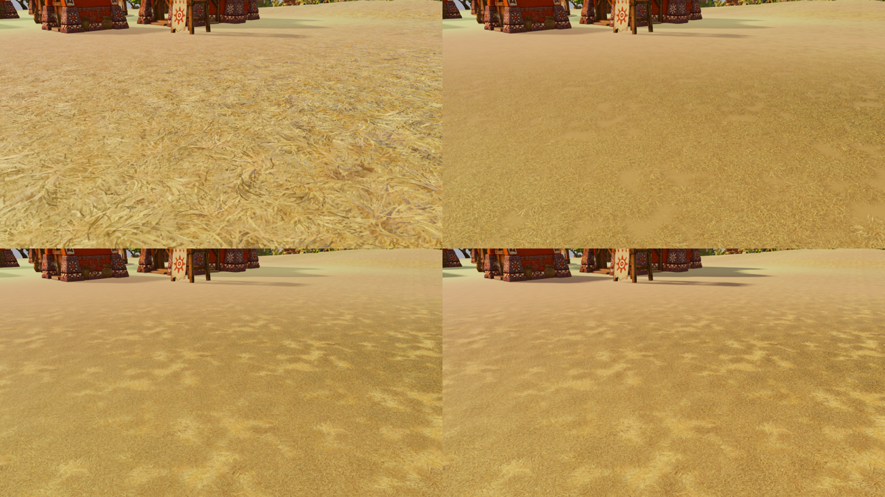

# Material horneado de fibras: resultado provisional descartado

2026-10-20. Continuación del ensayo ground-pom; no cambia el renderer por defecto. No se ha alcanzado la dirección artística del mockup.

## Evidencia visual

Arriba izquierda A original; arriba derecha J con mapas coherentes de superficie y oclusión trazada; abajo izquierda K con acumulaciones horneadas y fondo original; abajo derecha L con mayor proporción solar y menor ambiente diurno. Son capturas reales, reducidas a 640×360 por cuadrante; los originales locales son 1280×720.

A conserva fibras reconocibles, pero tiene discontinuidades de POM. J suaviza ese problema y parece césped fino. K/L introducen variación amplia, pero el conjunto recuerda fieltro y pierde la estructura de fibras secas buscada. L no proporciona un salto de volumen suficiente. Decisión: no integrar ni extender estos mapas a otros biomas; conservarlos como experimento descartado.

La geometría de Poly Haven se utilizó exclusivamente offline en Blender para producir mapas. No se añadieron mallas, instancias ni draws al juego. Fuente CC0: https://polyhaven.com/a/grass_medium_01 ; atribución y configuración en bake-provenance.json y archivos physical/mounded asociados.

## Controles y límites

Capturas de campaña real, semilla 712, 1280×720, calidad media, simulación pausada; cámaras y horas exactas en captures-media.json. Este manifiesto conserva A/J/K/A2/L, veinte registros. Las capturas G/H/I locales son exploratorias y no conservan registros completos en el manifiesto final.

control-audit.json confirma igualdad exacta A/A2 en ambas cámaras, día y noche; K/L también son idénticas de noche. Contadores de escena: 80 draws / 1 096 223 triángulos cerca y 70 / 919 436 en cámara normal. Esto verifica ausencia de geometría adicional, no coste de shading.

No hay benchmark GPU/CPU independiente ni validación temporal completa de estas variantes. Se descartan por calidad visual antes de ese gasto; no se presenta una mejora de rendimiento ni equivalencia de coste. Las capturas y scripts de exploración completos siguen locales; esta entrega publica la comparativa, manifiesto y auditorías que sustentan la decisión.

## Corrección del diagnóstico anterior

Un bake conocido y coherente produce correlaciones muy bajas entre derivadas del height map y normales de superficie: X −0.0236, Y −0.0243. Las discontinuidades entre fibras superpuestas generan pendientes en el height field que no son las normales de las superficies visibles. Por ello se retira la inferencia anterior de que una correlación baja demostraba incompatibilidad de los mapas originales. Véase normal-coherence-counterexample.json. La procedencia y alineación originales siguen sin demostrarse; esta prueba no las confirma ni las refuta.

## Siguiente dirección

El ensayo identifica límites artísticos de estos mapas, no prueba que todo POM sea incapaz de mejorar el suelo. Para volumen con siluetas y viento, la investigación RHEA-GRASS-FEASIBILITY.md propone una ruta separada sobre matas 3D instanciadas. Primero animar las mismas matas y medir; mantener el experimento de suelo sin geometría separado.
