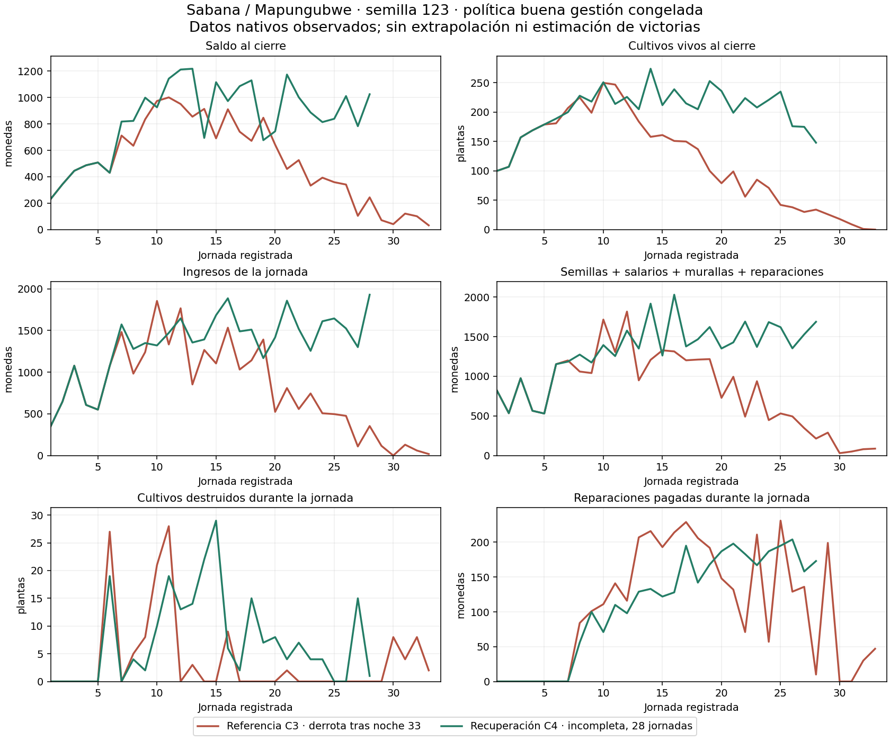

# Native recovery comparison: captured day-28 checkpoint

Sabana / Mapungubwe, seed 123, frozen good-management policy. C3 and C4 use the same corrected runtime apart from the three reviewed military files. The active C4 campaign has not been changed or restarted. Its captured prefix ends at day 28; C3 is terminal after 33 nights. Do not compare their all-prefix totals as equal-duration outcomes.

At the same recorded day 28:

| Observed field | C3 reference | C4 recovery |
|---|---:|---:|
| Closing money | 244 | 1,025 |
| Living crops at close | 34 | 148 |
| Income during the recorded day | 354 | 1,930 |
| Wages actually paid | 74 | 720 |
| Seeds actually purchased | 130 | 795 |
| Repairs actually paid | 10 | 173 |
| Crops destroyed during the recorded day | 0 | 1 |

These figures show a stronger productive position in the current candidate at this checkpoint. They do not establish 100-night survival, win rates or a completed calibration. Crop census is a closing state, not the raid-spawn exposure census; changes between censuses also reflect planting and harvesting. Use native `CropDestroyed` counts for attack losses rather than subtracting closing censuses. The daily recorded interval comes from `native-campaign-runner.mjs`, including its night processing and hiring transactions; a displayed worker count cannot reconstruct prorated wage totals.

`reference-prefix.json` and `recovery-prefix.json` were generated by the existing read-only journal auditor from completed newline-terminated rows. It checks consecutive days, opening/closing continuity, exact signed transaction totals/categories, unique transaction IDs and displayed balance. C4's 28 rows reconcile 6,590 transactions; C3's 33 rows reconcile 4,443. This accounting-only audit does not independently certify physical deliveries, human activity or campaign completion. The terminal C3 physical/economic audit is preserved separately in `reviewed-recovery-comparison/terminal-reference-seed123/`.

The full daily table and six-panel graph are generated from those immutable audited prefixes by `plot.py` (Matplotlib 3.9.2). The graph deliberately ends C4 at day 28 and draws no forecasts. Both series use shared axes, including all observed peaks. The graph was rendered and visually reviewed. `receipt.json` records hashes of its original data inputs. Run `python plot.py` to reproduce the image and table.

[Complete observed daily table](daily-table.md). Subsequent progress and terminal artifacts must be preserved as new evidence rather than rewriting this historical checkpoint.
